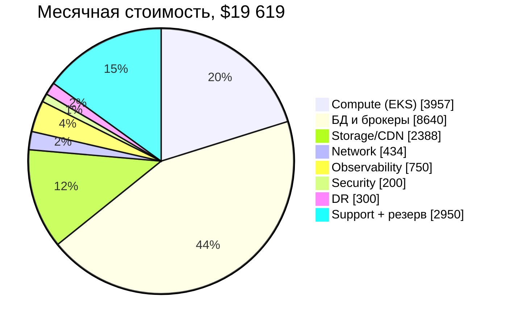

# ДЗ 4. Сайзинг, стоимость и оптимизация — решение

> Условие: [../Задание.md](../Задание.md). Выполняется для системы из ДЗ 2 —
> **сервиса бронирования** (маркетплейс отелей, авиабилетов и туров, аналог
> Ozon Travel / Яндекс Путешествия). Архитектура и хранилища — из
> [ДЗ 2](../../hw_02/solution/README.md) и [ДЗ 3](../../hw_03/solution/README.md).
>
> Все ключевые расчёты воспроизводятся скриптом [sizing.py](sizing.py):
> `python3 hw_04/solution/sizing.py`. В документе — те же числа, что печатает
> скрипт.

## 0. Резюме

| Показатель | Значение |
|---|---:|
| MAU / DAU | 3 000 000 / 300 000 |
| Броней в месяц | 3 000 000 (100 000/день) |
| Внешний API: средний / пиковый RPS | 152 / 762 |
| Supplier webhooks: средний / пиковый RPS | 231 / 1 157 |
| Пиковый SSE-конкурент | 286 соединений |
| Хранилище: 1 год / 3 года | 12,9 TB / 22,1 TB |
| Пиковый egress (API + CDN) | ≈ 350 Mbps |
| Трафик в интернет | 22,5 TB/мес |
| Приложение | 56 подов, 76 vCPU, 14 нод `c6i.2xlarge` |
| Инфраструктура AWS | **$16 668/мес** |
| С поддержкой и резервом 10% | **$19 619/мес** (≈ $235K/год) |
| После оптимизации | **$13 937/мес** (−29%, ≈ $68K/год) |
| Инфраструктурная себестоимость брони | $0,0056 (до оптимизации) / $0,0039 (после) |

Ключевой вывод: при 300K DAU и одной брони на пользователя в месяц **доминируют
не RPS бронирования, а поиск/выдача, поток обновлений от поставщиков и
стоимость БД**. Поэтому оптимизация должна начинаться с поиска, CDN и
commitments, а не с «экономии на инстансах Booking».

---

## 1. Исходные данные и допущения

### 1.1. Заданные параметры

| Параметр | Значение |
|---|---:|
| MAU | 3 000 000 |
| DAU | 300 000 |
| Броней на пользователя в месяц | 1 |
| Пиковый коэффициент в сезон отпусков | ×5 |
| Расчётный период | 1 год и 3 года |
| Месяц для стоимости | 30 дней, 730 часов |

### 1.2. Допущения, которые влияют на расчёт

Все допущения собраны в одном месте — их можно заменить и пересчитать скриптом.

| Допущение | Значение | Обоснование |
|---|---:|---|
| Поисков на DAU в день | 12 | travel — «долгий» фаннел: пользователь изучает направления и даты |
| Просмотров оффера на поиск | 2 | сравнение 2–3 вариантов на выдаче |
| Карточек property на DAU | 3 | deep link, страница отеля, повторный визит |
| Quote на бронь | 3 | проверка цены перед hold, смена тарифа, retry |
| Hold на бронь | 1,2 | часть hold истекает/отменяется до создания брони |
| Созданий брони на успешную бронь | 1,05 | retry идемпотентных запросов |
| Платежей на бронь | 1,1 | повторная попытка после `402` |
| Отмен | 12% от броней | типичный travel-показатель |
| «Мои брони» на DAU | 2 | список + карточка заказа |
| Длительность SSE-сессии | 45 с | ожидание подтверждения у поставщика |
| Событий поставщиков | 20 000 000/день | webhooks + polling: доступность, цены, статика |
| Пик | ×5 к среднему | сезон отпусков; это уже пиковый час, внутри дня ×2 повторно не применяем |
| Запас ёмкости | 30% | N+1 по AZ + burst |
| Рост трафика за 3 года | ×1,8 | CAGR ≈ 22% |
| Рост объёма данных за 3 года | ×1,7 | итог по таблице §3.2; заказы и архив не удаляются, rolling-данные — нет |

**Про пик.** Если понимать «×5 в сезон» как средний час сезона, а не пиковый,
то дизайн нужно умножить ещё на суточный коэффициент ×2. В работе принят более
распространённый вариант: **×5 — это уже расчётный пиковый час**. Для
чувствительности в §8 показано, что будет при ×10. Тот же коэффициент применяем
к webhook-потоку поставщиков; для supplier это консервативно, потому что его
обновления не привязаны к отпускам.

**Про чтение/запись.** `GET /search` и `GET /offers/{id}` — чтение; `POST /holds`,
`POST /bookings`, `POST /bookings/{id}/pay` — запись. Quote — чтение с расчётом
цены, но без изменения состояния.

### 1.3. Профиль нагрузки

```
Средний час:       152 RPS внешнего API + 231 RPS webhook поставщиков
Пиковый час:       762 RPS внешнего API + 1 157 RPS webhook поставщиков
Суточный профиль:  вне сезона ночью ~0,3×, обед/вечер ~2× от суточного среднего
Сезонный профиль:  июнь–август и новогодние праздники — до ×5 (это уже пиковый час)
```

---

## 2. Расчёт RPS

### 2.1. Формулы

```
RPS_avg  = N_ops_day / 86 400
RPS_peak = RPS_avg × K_peak,   K_peak = 5
N_ops_day = DAU × частота_на_DAU
```

Для броней:

```
Bookings_day = MAU × 1 / 30 = 3 000 000 / 30 = 100 000
```

### 2.2. Внешние эндпоинты

| Эндпоинт | Сервис | Тип | Операций/день | Ср. RPS | Пик RPS (×5) | p99 |
|---|---|---|---:|---:|---:|---:|
| `GET /search` | Search | чтение | 3 600 000 | 41,7 | 208 | 800 мс |
| `GET /offers/{id}` | Search | чтение | 7 200 000 | 83,3 | 417 | 300 мс |
| `GET /properties/{id}` | Catalog | чтение | 900 000 | 10,4 | 52 | 150 мс |
| `GET /bookings` | Booking | чтение | 600 000 | 6,9 | 35 | 200 мс |
| `GET /bookings/{id}/status` | Booking | чтение (SSE) | 110 000 | 1,3 | 6 | — |
| `POST /pricing/quote` | Inventory | чтение | 300 000 | 3,5 | 17 | 250 мс |
| `POST /holds` | Inventory | запись | 120 000 | 1,4 | 7 | 250 мс |
| `POST /bookings` | Booking | запись | 105 000 | 1,2 | 6 | 300 мс |
| `POST /bookings/{id}/pay` | Booking | запись | 110 000 | 1,3 | 6 | 800 мс |
| `POST /bookings/{id}/cancel` | Booking | запись | 12 000 | 0,1 | 1 | 300 мс |
| `POST /payments/callback` | Payment | запись | 110 000 | 1,3 | 6 | 200 мс |
| `POST /supplier/webhook` | Supplier | запись | 20 000 000 | 231,5 | 1 157 | 500 мс |
| **Итого внешний API без supplier** | — | — | **13 167 000** | **152,4** | **762** | — |

**Что важно в таблице:**

- Поиск и выдача дают **625 пиковых RPS** (208 + 417), то есть больше, чем все
  пользовательские write-операции вместе (≈ 27 RPS). Это read-heavy система.
- Поток поставщиков — **1 157 RPS** на входе; он не идёт через BFF и не
  масштабируется вместе с пользовательским трафиком. Это отдельный контур,
  который нужно буферизовать Kafka и батчить.
- `POST /bookings/{id}/pay` — низкий RPS, но высокий p99: внутри синхронный
  вызов Payment и (частично) Supplier. Для ёмкости важнее не RPS, а таймауты и
  идемпотентность.

### 2.3. Внутренние вызовы и fan-out

Пользовательский RPS не равен внутреннему: Search агрегирует Catalog и
Inventory, BFF проксирует сервисы, Booking вызывает Payment и Supplier.

| Внутренний вызов | Пик RPS | Payload | Протокол |
|---|---:|---:|---|
| BFF → Search (search + offer) | 625 | 5 KB | REST/gRPC |
| Search → Catalog (батч по id) | 208 | 20 KB | gRPC |
| Search → Inventory (снимок цен) | 208 | 20 KB | gRPC |
| BFF → Catalog | 52 | 8 KB | gRPC/REST |
| BFF → Inventory | 24 | 3 KB | gRPC/REST |
| BFF → Booking | 50 | 3 KB | REST |
| Booking → Payment | 6 | 2 KB | gRPC |
| Booking → Inventory | 6 | 2 KB | gRPC |
| Booking → Supplier | 6 | 2 KB | gRPC |

Итого внутренний синхронный трафик — **≈ 1 185 вызовов/с** в пике. Он не
умножается на количество реплик БД: Catalog/Inventory читаются батчами, а
Search кэширует выдачу на 45 с (см. ДЗ 3).

### 2.4. SSE-соединения

SSE — это не RPS, а количество одновременных соединений. Считаем по закону
Литтла:

```
L = λ × W
λ = 110 000 / 86 400 = 1,27 соединения/с
W = 45 с
L_avg = 1,27 × 45 ≈ 57 соединений
L_peak = 57 × 5 ≈ 286 соединений
```

286 SSE-соединений — это меньше 1 MB/s полезной нагрузки (события маленькие),
но каждое соединение занимает файловый дескриптор и память. Держим SSE на
отдельном пуле BFF с `proxy_buffering off` и heartbeat раз в 15 с.

### 2.5. События Kafka

| Поток | Событий/день | Средний/с | Пик/с | Payload | Retention |
|---|---:|---:|---:|---:|---:|
| `inventory.availability` / `inventory.prices` | 20 000 000 | 231 | 1 157 | 1,5 KB | 7 дней |
| `booking.events` | 105 000 | 1,2 | 6 | 1 KB | 7 дней |
| `payment.events` | 110 000 | 1,3 | 6 | 1 KB | 7 дней |
| `supplier.booking-results` | 110 000 | 1,3 | 6 | 1 KB | 7 дней |
| `booking.reminders` | 100 000 | 1,2 | 6 | 1 KB | 30 дней |
| **Итого** | **≈ 20,4M** | **236** | **1 181** | — | — |

Партиционирование:

- `inventory.*` — 24 партиции по `property_id` (порядок обновлений одного отеля);
- `booking.events` — 12 партиций по `booking_id`;
- `payment.events` — 6 партиций по `booking_id`;
- `notification` — 6 партиций, ключ `event_id`.

При 1 181 событии/с и 1,5 KB среднем размере это ≈ 1,8 MB/s на входе; с RF=3
и служебным трафиком — ≈ 6–7 MB/s на брокерах. Три брокера `kafka.m5.xlarge`
выдерживают с запасом; узкое место — не throughput, а retention и стоимость
диска.

### 2.6. Проверка на пик и рост

| Сценарий | Внешний API, RPS | Комментарий |
|---|---:|---|
| Средний день | 152 | базовый режим |
| Пиковый час сезона (×5) | 762 | расчётная ёмкость |
| Burst +30% к пику | 991 | запас на ретраи и «толпу» |
| Через 3 года (×1,8) | 1 372 | план роста: +80% vCPU |

Ёмкость в §5 проектируется на **пик ×5 с запасом 30%**, а не на средний день.
Именно поэтому 762 RPS дают 76 vCPU по CPU-модели и 112 vCPU / 14 нод с запасом,
а не 20 vCPU «по среднему».

---

## 3. Расчёт хранилища

### 3.1. Формулы

```
S_raw   = N_записей × s_записи
S_disk  = S_raw × k_overhead × RF
S_3y    = S_1y × 3 × k_growth         — для растущих данных (заказы, платежи)
S_3y    = S_1y × k_growth             — для rolling-данных (календарь, индекс)
```

Где `k_overhead` — индексы, TOAST, запас на compaction (1,3–2,0),
`RF` — replication factor (3 для Scylla/Mongo; 2 для OpenSearch; для
PostgreSQL Multi-AZ и read replica учтены в `k_overhead` и бэкапах, а не
отдельным множителем RF3).

В расчёте 1 TB = 1024 GB, 1 GB = 1024 MB — как в `sizing.py`; это же
соглашение используется в таблицах. `k_growth` для каждой сущности свой:
1,2–1,5 для rolling-данных и справочников, 3,9 для заказов и платежей;
итоговый рост по таблице — ×1,7.

### 3.2. По сервисам

| Сущность | Расчёт | 1 год | 3 года | Комментарий |
|---|---|---:|---:|---|
| Catalog (MongoDB) | 1M × 30 KB × 1,3 × RF3 | 0,11 TB | 0,16 TB | версии карточек за 3 года |
| Search (OpenSearch) | 1M × 20 KB × 1,3 × 2 копии | 0,05 TB | 0,06 TB | rolling-индекс + snapshots |
| Inventory (ScyllaDB) | 657M ячеек × 64 B × 1,3 × RF3 | 0,15 TB | 0,18 TB | календарь rolling 365 дней |
| Booking (PostgreSQL) | 36M × 3 KB × 1,8 × 1,5 | 0,27 TB | 1,06 TB | заказы, гости, Saga, outbox |
| Payment (PostgreSQL) | 40M × 1,5 KB × 2 × 1,5 | 0,17 TB | 0,65 TB | платежи, возвраты, идемпотентность |
| Supplier (PostgreSQL) | 20M/день × 7 дней × 1,5 KB × 2 | 0,39 TB | 2,00 TB | hot 7 дней + холодный архив |
| Kafka | 21M/день × 7 дней × 1,5 KB × RF3 × 1,3 | 0,80 TB | 0,96 TB | tiered storage — резерв |
| S3: фото и превью | 1M × 20 фото × 300 KB + превью | 8,00 TB | 12,00 TB | origin для CDN |
| S3: бэкапы, логи, архив | PG + OpenSearch + webhook-архив | 3,00 TB | 5,00 TB | lifecycle в IA/Glacier |
| **Итого** | — | **12,94 TB** | **22,07 TB** | без учёта реплик CDN |

### 3.3. Пояснения к расчёту

**Inventory — самый большой «горячий» OLTP-объём, но он не растёт линейно.**
Календарь хранит только будущие 365 дней:

```
600 000 активных объектов × 3 тарифа × 365 дней = 657 000 000 ячеек
657M × 64 B = 39,1 GB raw
39,1 GB × 1,3 (compaction) × 3 (RF) = 152,7 GB
```

Через 3 года это не 3×152 GB, а ≈ 183 GB: старые даты уходят из rolling-окна.
Историю цен в Scylla не храним — для аудита достаточно snapshot в S3.

**Booking и Payment растут линейно.**

```
Booking: 36M броней/год × 3 KB = 103 GB raw
103 GB × 1,8 (индексы/TOAST) × 1,5 (WAL+бэкап) = 278 GB/год
3 года × 1,3 (рост) = 1,06 TB
```

**Supplier — это не «ещё одна OLTP-таблица», а inbox.** 20M webhook в день
нельзя хранить 3 года в PostgreSQL: 20M × 1,5 KB = 30 GB/день. Поэтому:

- hot-inbox 7 дней — 0,39 TB (дедупликация, разбор ошибок);
- дальше — только агрегаты и audit в S3 (2 TB за 3 года);
- сырые payload’ы старше 7 дней удаляются.

**Фото — главный объём вне БД.** 1M объектов × 20 фото × 300 KB = 6 TB origin;
плюс превью и версии — 8 TB. В БД храним только URL и метаданные, не бинарники.

### 3.4. Итог по годам

| Слой | 1 год | 3 года | Рост |
|---|---:|---:|---:|
| БД (Scylla + PG + Mongo) | 1,09 TB | 4,05 TB | ×3,7 |
| Поисковый индекс | 0,05 TB | 0,06 TB | ×1,2 |
| Kafka | 0,80 TB | 0,96 TB | ×1,2 |
| Object storage (фото, бэкапы) | 11,00 TB | 17,00 TB | ×1,5 |
| **Всего** | **12,94 TB** | **22,07 TB** | **×1,7** |

---

## 4. Расчёт bandwidth

### 4.1. Формулы

```
B_peak_Mbps = Σ (RPS_peak_i × S_response_i × 8 / 1024)
B_month_TB  = Σ (N_ops_day_i × 30 × S_response_i / 1024³)
```

`S` — размер ответа **после gzip/brotli** (JSON сжимается в 3–5 раз). Сырой
JSON поиска — 60 KB, на проводе — 20 KB.

### 4.2. Внешний API

| Поток | Пик, Mbps | В месяц, TB |
|---|---:|---:|
| API egress (ответы клиентам) | 72 | 4,48 |
| API ingress (запросы клиентов) | 21 | 1,29 |
| Supplier ingress (webhooks) | 181 | 11,18 |
| CDN (фото и превью) | 278 | 18,00 |
| **Итого egress** | **350** | **22,48** |
| **Итого ingress** | **202** | **12,47** |

Детализация egress:

| Эндпоинт | Пик, Mbps | В месяц, TB |
|---|---:|---:|
| `GET /search` (20 KB) | 33 | 2,01 |
| `GET /offers/{id}` (10 KB) | 33 | 2,01 |
| `GET /properties/{id}` (8 KB) | 3 | 0,20 |
| `GET /bookings` (12 KB) | 3 | 0,20 |
| Остальные API (quote, holds, bookings, pay) | <1 | 0,06 |
| **API всего** | **72** | **4,48** |

CDN:

```
300 000 DAU × 20 фото/день × 100 KB = 600 GB/день
600 GB/день / 86 400 × 8 = 55,6 Mbps в среднем
55,6 Mbps × 5 = 278 Mbps в пике
600 GB × 30 = 18 TB/мес
```

### 4.3. Внутренний трафик

| Поток | Пик, MB/s | Комментарий |
|---|---:|---|
| BFF → сервисы | 3,8 | 754 RPS × 5 KB |
| Search → Catalog / Inventory | 8,3 | 2 × 208 RPS × 20 KB |
| Booking → Payment / Inventory / Supplier | 0,04 | 6 RPS × 2 KB × 3 |
| Kafka produce/consume | 6,9 | 1 181 событий/с × 1,5 KB × RF3 × 1,3 |
| Репликация БД и индексация | 2,0 | потоковое, вне критического пути |
| **Итого внутренний** | **≈ 21** | ≈ 170 Mbps |

### 4.4. Требования к пропускной способности

| Уровень | Требование | Почему |
|---|---:|---|
| Internet egress (API + CDN) | **1 Gbps** | пик 350 Mbps + запас ×3 на сезон и CDN-всплески |
| Internet ingress | **1 Gbps** | пик 202 Mbps, но supplier-трафик «рваный» |
| Внутренняя сеть | **10 Gbps** | 21 MB/s в пике, но репликация и recovery дают burst |
| CDN | **1 Gbps**, 18 TB/мес | фото — доминирующий egress |
| Kafka | **3 × 1 Gbps** | RF3, producer + consumer + replication |
| БД | **10 Gbps** между AZ | репликация и бэкапы |

**Узкое место — не средний трафик, а supplier webhooks.** 1 157 RPS × 20 KB
= 23 MB/s в пике; если поставщик пришлёт пакет обновлений «все отели на
выходные», это может быть ×3 к расчёту. Поэтому Supplier Integration пишет
входящие в Kafka, а не напрямую в Inventory.

---

## 5. Оценка ресурсов

### 5.1. Модель CPU

```
C_100 = 1000 / t_cpu_ms          — RPS на 1 vCPU при 100%
C_60  = C_100 × 0,6              — целевая утилизация 60% на пике
N_vCPU = RPS_peak / C_60
N_pods = max(6, ceil(N_vCPU / vCPU_per_pod))
```

Минимум 6 подов на сервис — это **3 AZ × 2 пода** для отказоустойчивости, даже
если по CPU хватило бы одного.

60% — это целевая утилизация *выделенных* vCPU на пике, а 30% из §1.2 —
запас на уровне нод: 76 требуемых vCPU против 112 доступных. Это два разных
контроля (headroom на поде и N+1/burst на кластере), а не два множителя к RPS.

| Сервис | Пик RPS | CPU/запрос, мс | RPS на vCPU (60%) | Нужно vCPU | Поды | vCPU итого | RAM, ГБ |
|---|---:|---:|---:|---:|---:|---:|---:|
| BFF / API Gateway | 754 | 3 | 200 | 3,8 | 6 | 12 | 18 |
| Search & Offer | 625 | 25 | 24 | 26,0 | 14 | 28 | 84 |
| Catalog | 302 | 5 | 120 | 2,5 | 6 | 6 | 12 |
| Inventory & Pricing | 245 | 10 | 60 | 4,1 | 6 | 6 | 24 |
| Booking | 50 | 20 | 30 | 1,7 | 6 | 6 | 9 |
| Payment | 14 | 20 | 30 | 0,5 | 6 | 6 | 9 |
| Supplier Integration | 1 170 | 2 | 300 | 3,9 | 6 | 6 | 9 |
| Notification | 18 | 5 | 120 | 0,1 | 6 | 6 | 3 |
| **Итого** | — | — | — | — | **56** | **76** | **168** |

Пик RPS в таблице — это нагрузка на сервис, а не на внешний эндпоинт: Catalog
получает batch-вызовы от Search, Inventory — от Search и Booking, Supplier —
webhooks и вызовы Booking. Поэтому цифры выше, чем в §2.2.

Почему Search требует 28 vCPU при 625 RPS: 25 мс CPU на запрос — это
агрегация, фильтры, ранжирование и сериализация protobuf. Это самый
CPU-ёмкий сервис, и именно он определяет размер кластера приложений.

### 5.2. Kubernetes-ноды

| Параметр | Значение |
|---|---:|
| Ноды | 14 × `c6i.2xlarge` (8 vCPU / 16 GB) |
| Всего vCPU / RAM | 112 vCPU / 224 GB |
| Утилизация CPU на пике | 76 / 112 = **68%** |
| Утилизация RAM на пике | 168 / 224 = **75%** |
| Запас | 32% CPU / 25% RAM, N+1 по AZ |
| Автоскейлинг | 10–16 нод, HPA по CPU/RPS |

14 нод — это не «ровно по CPU», а минимальное число, дающее ≥30% свободной
ёмкости: 112 − 76 = 36 vCPU, то есть 32% от 112 (у 13 нод было бы 27%, у 12 —
21%). Раскладка 5 + 5 + 4 по AZ плюс 25% запаса RAM. N+1 по AZ обеспечивается
не статическим резервом, а Karpenter: при потере AZ кластер добавляет ноды в
живых зонах (до 16), поэтому круглый год не платим за простой худшей зоны.

### 5.3. Кластеры БД и инфраструктурные сервисы

| Компонент | Конфигурация | Кол-во | Обоснование |
|---|---|---:|---|
| OpenSearch | `r6g.2xlarge.search` (8 vCPU / 64 GB), 100 GB gp3 | 3 data + 3 master | 0,05 TB индекса, 625 RPS поиска, 1 replica |
| ScyllaDB | `i4i.xlarge` (4 vCPU / 32 GB / 937 GB NVMe) | 6 | RF3, rolling-календарь, пик записи ≈ 6K строк/с |
| Booking PostgreSQL | `r6g.xlarge` Multi-AZ + read replica, 1 TB gp3 | 1 primary + standby + 1 replica | ACID, outbox, 36M заказов/год |
| Payment PostgreSQL | `r6g.large` Multi-AZ + read replica, 500 GB gp3 | 1 primary + standby + 1 replica | деньги, идемпотентность, 40M платежей/год |
| Supplier PostgreSQL | `r6g.large` Multi-AZ, 500 GB gp3 | 1 primary + standby | inbox 7 дней, маппинг, дедуп |
| Redis | `cache.r6g.large` (13 GB) | 3 шарда × 1 replica | кэш карточек, выдачи, дедуп |
| Kafka (MSK) | `kafka.m5.xlarge`, 1 TB gp3 | 3 брокера | 1 181 событий/с, RF3, 7 дней |
| Object storage | S3 Standard + IA/Glacier | 15 TB | фото, превью, бэкапы |
| CDN | CloudFront | — | 18 TB/мес, 278 Mbps пик |

### 5.4. Как считались кластеры

**OpenSearch.**

```
Индекс: 1M документов × 20 KB × 1,3 = 26 GB
С replica: 26 × 2 = 52 GB
С запасом 20%: 63 GB
3 data nodes × 100 GB = 300 GB — с запасом на сегменты и snapshots
```

625 RPS поиска при 3 × 8 vCPU = 24 vCPU. OpenSearch обычно упирается не в CPU,
а в heap и GC; 64 GB RAM на ноду, heap 50% (31 GB), остальное — page cache.
3 master-ноды — кворум для управления кластером.

**ScyllaDB.**

```
657M ячеек × 64 B = 39 GB raw
× 1,3 compaction × 3 RF = 153 GB
Пик записи: 1 157 событий/с × 5 ячеек = 5 785 строк/с
Пик чтения: 245 RPS × 20 строк = 4 900 строк/с
```

6 нод `i4i.xlarge` дают 24 vCPU и 5,6 TB raw NVMe. Это избыточно по диску
(153 GB), но нужно для RF3 + N+1 и для пиков записи. 3 ноды пережили бы один
отказ, но не дают запаса на обслуживание: при ремонте одной ноды и отказе
второй кворум теряется.

**PostgreSQL.**

```
Booking: 36M строк/год × 3 KB = 103 GB/год
+ индексы 1,8 + WAL/бэкап 1,5 = 278 GB/год
3 года + 30% рост = 1,06 TB
Write RPS ≈ 6, read RPS ≈ 35 — 4 vCPU более чем достаточно
```

Booking и Payment — не по CPU, а по ACID, диску и бэкапам. Multi-AZ + read
replica — минимум для HA и «моих броней». Read replica не спасает от записи,
но снимает read-нагрузку и позволяет делать бэкапы без влияния на primary.

**Kafka.**

```
21M событий/день × 1,5 KB = 31,5 GB/день
× 7 дней × RF3 × 1,3 = 0,86 TB
3 брокера × 1 TB = 3 TB raw
```

Партиции: 24 для inventory (порядок по `property_id`), 12 для booking, 6 для
payment, 6 для notification. 3 брокера — минимум для RF3; при росте до 5
брокеров добавляются партиции и rebalance.

**Redis.**

```
Кэш карточек: 1M × 30 KB × 10% горячих = 3 GB
Кэш выдачи: 208 RPS × 45 с × 20 KB = 0,2 GB
Дедуп, сессии, счётчики: 1–2 GB
Итого working set ≈ 6 GB; 3 шарда × 13 GB = 39 GB — с запасом на фрагментацию
```

### 5.5. План роста на 3 года

| Ресурс | Год 1 | Год 2 | Год 3 |
|---|---:|---:|---:|
| Внешний API, пик RPS | 762 | 1 020 | 1 372 |
| App-ноды `c6i.2xlarge` | 14 | 18 | 24 |
| ScyllaDB-ноды | 6 | 7 | 8 |
| OpenSearch data-ноды | 3 | 4 | 5 |
| Booking PG | 1 primary + replica | 2 шарда | 4 шарда |
| Kafka-брокеры | 3 | 4 | 5 |
| Хранилище | 12,9 TB | 17,5 TB | 22,1 TB |
| Инфраструктура, $/мес | 16 700 | 21 000 | 27 000 |
| С support/резервом, $/мес | 19 600 | 24 600 | 31 600 |

К году 3 один primary Booking PG перестаёт быть комфортным по записи и
бэкапам — переходим на 4 шарда по `user_id` (план из ДЗ 3). Scylla и Kafka
масштабируются добавлением нод; OpenSearch — добавлением data-нод и
переиндексацией.

---

## 6. Расчёт стоимости

### 6.1. Модель и допущения

- **Облако:** AWS, регион `eu-central-1` (Франкфурт — ближе к RU-пользователям,
  чем `us-east-1`).
- **Цены:** публичный on-demand лист, USD, без НДС, 730 часов/мес, округлены.
  Зафиксированы на **2026-10**; при пересчёте использовать AWS Pricing
  Calculator.
- **Что включено:** compute, managed DB, OpenSearch, Redis, Kafka, S3,
  CloudFront, NAT, LB, observability, security, cross-region backup.
- **Egress:** CloudFront отдаёт и статику, и API-ответы; его 22,8 TB включают
  18 TB CDN и 4,5 TB API egress. NAT в смете — только cross-AZ и служебный
  трафик, поэтому интернет-egress не считается дважды.
- **Что не включено:** эквайринг и комиссия платёжного провайдера, SMS,
  поддержка пользователей, налоги, скидки enterprise-контрактов.
- **Support:** AWS Business Support 7% от инфраструктуры.
- **Резерв:** 10% на непредвиденные requests, cross-AZ traffic, snapshots.

### 6.2. Стоимость по компонентам

| Категория | Компонент | $/мес |
|---|---|---:|
| Compute | EKS workers: 14 × `c6i.2xlarge` (8 vCPU / 16 GB) | 3 822 |
| Compute | EKS control plane | 73 |
| Compute | EBS для нод: 700 GB gp3 | 62 |
| Databases | OpenSearch: 3 × `r6g.2xlarge.search` + 3 × `m6g.large.search` + 600 GB gp3 (data + master + snapshots) | 1 112 |
| Databases | ScyllaDB: 6 × `i4i.xlarge` (4 vCPU / 32 GB / 937 GB NVMe) | 2 177 |
| Databases | Booking PostgreSQL: `r6g.xlarge` Multi-AZ + read replica + 1 TB | 1 505 |
| Databases | Payment PostgreSQL: `r6g.large` Multi-AZ + read replica + 500 GB | 753 |
| Databases | Supplier PostgreSQL: `r6g.large` Multi-AZ + 500 GB | 560 |
| Databases | ElastiCache Redis: 3 шарда × 1 реплика, `cache.r6g.large` | 1 091 |
| Databases | MSK: 3 × `kafka.m5.xlarge` + 3 TB EBS + transfer | 1 442 |
| Storage/CDN | S3: 15 TB с версиями (фото, превью, бэкапы, логи) | 418 |
| Storage/CDN | CloudFront: 22,8 TB egress + requests (18 TB CDN + 4,5 TB API) | 1 970 |
| Network | NAT Gateway + cross-AZ traffic | 264 |
| Network | ALB/NLB | 170 |
| Observability | CloudWatch logs/metrics + X-Ray | 750 |
| Security | WAF, KMS, Secrets Manager | 200 |
| DR | Cross-region backups, snapshots | 300 |
| | **Инфраструктура** | **16 668** |
| | AWS Business Support (7%) | 1 167 |
| | Резерв на непредвиденное (10%) | 1 784 |
| | **Итого в месяц** | **19 619** |
| | **Итого в год** | **235 424** |

Сумма строк может отличаться от итога на $1: статьи округлены до целого
доллара, а итог и support/резерв считаются по точным значениям.

### 6.3. Структура затрат



**Что видно из структуры:**

- 44% — БД и брокеры, а не «сервера приложений». Это следствие выбора
  managed-сервисов и HA (Multi-AZ, RF3, replicas).
- 20% — compute; больше трети из них — Search, который ест CPU на ранжирование.
- 12% — storage/CDN; фото и выдача дешевле, чем кажется, но CDN — заметная
  статья.
- 15% — support и резерв; если их не учитывать, получается «красивая», но
  нереалистичная цена.

### 6.4. Unit economics

| Метрика | До оптимизации | После оптимизации |
|---|---:|---:|
| Инфраструктура, $/мес | 16 668 | 11 841 |
| С support/резервом, $/мес | 19 619 | 13 937 |
| На бронь (3M/мес), инфраструктура | $0,0056 | $0,0039 |
| На бронь, полная стоимость | $0,0065 | $0,0046 |
| На DAU, полная стоимость | $0,065 | $0,046 |
| На 1 000 API-запросов (395M/мес) | $0,0497 | $0,0353 |

Инфраструктурная себестоимость брони — **меньше цента**. Основная стоимость
travel-брони — не железо, а платёжная комиссия, поддержка и маркетинг; это
важно для бизнес-кейса, но выходит за рамки ДЗ.

### 6.5. Если размещать в Yandex Cloud

Структура затрат сохранится, меняются только прайс-листы и налоги. Соответствие
сервисов:

| AWS | Yandex Cloud |
|---|---|
| EC2 / EKS | Compute Cloud / Managed Kubernetes |
| RDS PostgreSQL | Managed Service for PostgreSQL |
| OpenSearch Service | Managed Service for OpenSearch |
| ElastiCache Redis | Managed Service for Redis |
| MSK | Managed Service for Apache Kafka |
| S3 | Object Storage |
| CloudFront | CDN |
| CloudWatch | Monitoring + Logging |

Для RU-сегмента Yandex Cloud может быть дешевле по egress и дороже по compute;
итоговый чек нужно пересчитывать в калькуляторе Yandex Cloud с теми же
параметрами (14 нод, 6 Scylla, 3 OpenSearch, 3 Kafka). Ориентир — тот же
порядок **$16–20K/мес**; разница в пределах ±20% не меняет архитектурных
выводов. Если есть требование хранить персональные данные в РФ (152-ФЗ), AWS
не подходит — Yandex Cloud становится основным вариантом, а не альтернативой.

---

## 7. Оптимизация

### 7.1. Принципы

1. **Не режем качество:** сохраняем Multi-AZ, RF3, 7-дневный PITR, SLO p99.
2. **Сначала устраняем избыточное резервирование, потом покупаем скидку.**
   Бессмысленно покупать RI на 16 нод, если после right-sizing нужно 12.
3. **Сезонность — главный рычаг.** Пик ×5 бывает 3–4 месяца в году; платить за
   него 12 месяцев — самая дорогая ошибка.
4. **Кэш и сжатие дешевле железа.** 45-секундный кэш поиска и AVIF/WebP
   экономят больше, чем ещё один узел.

### 7.2. Пять предложений

| # | Мероприятие | Экономия, $/мес | Риск и как снимаем |
|---|---|---:|---|
| 1 | 1-летние Savings Plans / RI на 60% steady-state (compute, RDS, OpenSearch, Redis, MSK) | 1 533 | commitment; покрываем только 60% базы, 1-year no upfront |
| 2 | Сезонный autoscaling + 20–25% Spot для Supplier/Notification | 1 112 | spot interruption; PDB, mixed instances, on-demand база 75% |
| 3 | CDN: AVIF/WebP, responsive-превью, immutable cache; lifecycle S3 | 800 | качество картинок; fallback JPEG, A/B |
| 4 | ScyllaDB 6→4 узла + Kafka tiered storage (24 ч hot, 7 дней cold) | 998 | пиковая запись; load-test ×2, RF3 сохраняем |
| 5 | OpenSearch right-size + кэш поиска 45 с + singleflight | 384 | p99 поиска; canary, 3 data nodes, SLO-алерт |
| | **Итого прямая экономия** | **4 827** | **−29% к счёту** |

#### 1. Commitments на steady-state

Что делаем:

- 1-летние Compute Savings Plans на 60% baseline (не на пик);
- Reserved Instances для RDS, OpenSearch, ElastiCache, MSK — тоже 60%;
- остальное — on-demand/spot, чтобы не платить за сезонный простой.

Почему 60%, а не 100%: пик ×5 и рост ×1,8 делают жёсткие commitment рискованными.
60% — это та часть нагрузки, которая есть всегда (ночные часы, межсезонье).

Экономия: 30% от eligible steady-state ≈ **$1 533/мес**:

```
eligible = app ≈2 710 (10 baseline-нод) + БД 2 818 + OpenSearch 728 + Redis 1 091 + MSK 1 170 = 8 517
8 517 × 0,6 × 0,3 ≈ 1 533
```

10 baseline-нод — межсезонный минимум; пиковые 14–16 нод commitment не покрываем.
Scylla в eligible не включаем: сначала right-size (п. 4), иначе commitment
зафиксирует лишние 2 ноды.
При 3-летнем сроке скидка выше, но гибкость ниже; для стартапа 1 год — разумный
компромисс.

#### 2. Сезонный autoscaling + Spot

Что делаем:

- HPA/Karpenter: 8–10 нод в межсезонье, 14–16 в пик;
- 20–25% Spot для Supplier Integration и Notification (они устойчивы к
  прерыванию: работают через Kafka и ретраи);
- Booking/Payment/Search — on-demand, потому что latency и деньги.

Экономия: ≈ **$1 112/мес**. Оценка: 5 нод × $273 × 7/12 ≈ $796 (сезонное
снижение) + ≈ $220 (Spot и более плотная упаковка подов) + ≈ $96 (scheduling
и округление). Риск: Spot может забрать под в неудачный момент; лечим
`PodDisruptionBudget`, mixed instance types и тем, что критический путь не
зависит от Spot.

#### 3. CDN и медиа

Что делаем:

- AVIF/WebP вместо JPEG, responsive-превью (200/400/800 px);
- `Cache-Control: immutable` для URL с hash;
- lifecycle: фото старше 90 дней — в IA, старше года — в Glacier;
- edge-кэш анонимной поисковой выдачи на 30 с (не персонализированной).

Экономия: ≈ **$800/мес** (CDN 18 → 12 TB, S3 lifecycle). Оценка:
6 TB × $0,085/GB ≈ $522 + lifecycle S3 ≈ $105 + edge-кэш выдачи ≈ $173. Риск:
качество картинок; проверяем A/B и оставляем JPEG fallback.

#### 4. ScyllaDB и Kafka

Что делаем:

- Scylla 6 → 4 узла `i4i.xlarge` (RF3 сохраняется, 4 узла — минимум для
  обслуживания без потери кворума);
- Kafka tiered storage: hot 24 часа на broker EBS, cold 7 дней в S3;
- батчинг обновлений поставщиков (coalescing по `property_id` + 1 с).

Экономия: ≈ **$998/мес**. Оценка: 2 × `i4i.xlarge` × $0,497 × 730 ≈ $726
(Scylla) + ≈ $272 (Kafka tiered storage). Риск: пиковая запись 5,8K строк/с;
проверяем load-test ×2 к пику, смотрим p99 записи и compaction. Если не
проходит — возвращаем 5-й узел, экономия остаётся положительной.

#### 5. OpenSearch и кэш поиска

Что делаем:

- 3 × `r6g.2xlarge.search` → 3 × `r6g.xlarge.search` (12 vCPU вместо 24);
- кэш выдачи 45 с + singleflight на промахе (уже заложено в ДЗ 3, но здесь
  фиксируем эффект);
- `index.sort` по дате, чтобы чаще бить в page cache;
- отключаем дорогие `wildcard`-запросы, оставляем фасеты и geo.

Экономия: ≈ **$384/мес**. Оценка: 3 × ($0,369 − $0,202) × 730 ≈ $366 + эффект
кэша. Риск: p99 поиска; canary 10% трафика, SLO-алерт на
`search_p99 > 800ms`, откат одной командой.

### 7.3. Итог оптимизации

| Показатель | До | После | Δ |
|---|---:|---:|---:|
| Инфраструктура, $/мес | 16 668 | 11 841 | −4 827 (−29%) |
| Support + резерв, $/мес | 2 950 | 2 096 | −854 |
| **Итого, $/мес** | **19 619** | **13 937** | **−5 682 (−29%)** |
| **Итого, $/год** | **235 424** | **167 244** | **−68 180** |
| На бронь, полная стоимость | $0,0065 | $0,0046 | −29% |

### 7.4. Порядок внедрения

| Шаг | Что | Экономия | Риск |
|---|---|---:|---|
| 1 месяц | сезонный autoscaling + Spot и CDN/медиа | $1 912 | низкий |
| 2 месяц | Scylla/Kafka/OpenSearch right-size после load-test | $1 382 | средний |
| 3 месяц | commitments на уже оптимизированный baseline | $1 533 | низкий |
| Далее | пересмотр раз в квартал | — | — |

### 7.5. Что сознательно не оптимизируем

| Что | Почему |
|---|---|
| Multi-AZ для Booking/Payment | простой оплаты дороже экономии 30% |
| RF3 в Scylla | потеря кворума = овербукинг |
| 7-дневный PITR | деньги и разбор инцидентов |
| On-demand для Search | p99 важнее 10% экономии на Spot |
| Полный отказ от read replica | «мои брони» и бэкапы без влияния на primary |

---

## 8. Чувствительность модели

Модель держится на допущениях. Ниже — как меняется ответ, если они другие.

| Сценарий | Что меняется | Влияние на стоимость |
|---|---|---:|
| Поисков не 12, а 6 на DAU | Search RPS ×0,5, −7 vCPU, −2 ноды | −$700/мес |
| Пик не ×5, а ×10 | +30–40% к compute/БД, +2 Kafka | +$4 000/мес |
| Supplier events 50M/день | +6 подов Supplier, +2 брокера, +2 Scylla | +$2 000/мес |
| Фото-трафик ×2 | CDN 36 TB/мес | +$1 800/мес |
| Рост за 3 года не ×1,8, а ×2,5 | 24→30 app-нод, 4→6 шардов PG | +$8 000/мес к году 3 |

Вывод: даже при худшем сценарии (пик ×10) система остаётся в порядке
**$25K/мес**, а оптимизации дают больше, чем разница между «аккуратным» и
«консервативным» допущением.

---

## 9. Проверка критериев задания

| Критерий | Как выполнен |
|---|---|
| Корректные формулы и расчёты | Формулы RPS, storage, bandwidth, CPU, Little’s law; все числа воспроизводятся `sizing.py` |
| Учтены пиковые нагрузки и рост | Пик ×5, burst +30%, план на 3 года ×1,8, отдельная таблица роста |
| Реалистичная оценка стоимости | AWS on-demand + support + 10% резерв; unit economics; исключены платёжные комиссии |
| Осмысленные предложения по оптимизации | 5 мер с экономией, рисками и порядком внедрения; −29% без потери SLO/HA |
| Формат сдачи | Расчёты с пояснениями, таблица ресурсов, стоимость по компонентам, оптимизация с оценкой |

### Что проверить на нагрузочном тесте (вход в ДЗ 5)

1. **Search p99** при 625 RPS и 70% cache hit — укладывается ли в 800 мс.
2. **Scylla write p99** при 5 785 строк/с — не растёт ли compaction.
3. **Booking → Payment** при 6 RPS и 800 мс p99 — нет ли блокировок на
   `idempotency_key`.
4. **SSE** 300 одновременных соединений — не течёт ли память BFF.
5. **Kafka lag** при 1 157 событий/с — успевает ли Inventory consumer.

---

## Приложение A. Все константы модели

| Константа | Значение |
|---|---:|
| MAU | 3 000 000 |
| DAU | 300 000 |
| Броней/мес | 3 000 000 |
| Броней/день | 100 000 |
| Пиковый коэффициент | 5 |
| Рост трафика за 3 года | 1,8 |
| Рост данных за 3 года | 1,7 |
| Поисков/DAU/день | 12 |
| Офферов/поиск | 2 |
| Property/DAU/день | 3 |
| Quote/бронь | 3 |
| Hold/бронь | 1,2 |
| Create/бронь | 1,05 |
| Pay/бронь | 1,1 |
| Cancel/бронь | 0,12 |
| Supplier events/день | 20 000 000 |
| SSE duration | 45 с |
| CPU utilization target | 60% |
| HA minimum | 6 подов (3 AZ × 2) |
| AWS region | eu-central-1 |
| Hours/month | 730 |
| Support | 7% |
| Reserve | 10% |

## Приложение B. Как пересчитать

```bash
python3 hw_04/solution/sizing.py
```

Скрипт не требует зависимостей. Чтобы изменить сценарий, отредактируйте
`ASSUMPTIONS`, `ENDPOINTS`, `service_load()`, `storage_table()` и `COST_ITEMS`
в `sizing.py` — таблицы пересчитаются автоматически.
