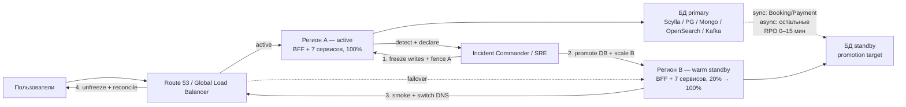

# ДЗ 5. Отказоустойчивость, observability и тестирование — решение

> Условие: [../Задание.md](../Задание.md)
> Шаблоны: [метрики](../Чек-лист%20метрик.md) · [алерты](../Шаблон%20описания%20алертов.md) ·
> [chaos-эксперименты](../Примеры%20Chaos-экспериментов.md). Схемы — в [diagrams/](diagrams/).
>
> Система — **сервис бронирования** из ДЗ 2: маркетплейс отелей, авиабилетов и туров
> (аналог Ozon Travel / Яндекс Путешествия). Декомпозиция и протоколы —
> [ДЗ 2](../../hw_02/solution/README.md), хранилища и CAP-решения —
> [ДЗ 3](../../hw_03/solution/README.md), сайзинг и стоимость — ДЗ 4.
>
> Расчётный масштаб: **3M MAU / 300K DAU**, 100K броней в день, пик ×5:
> **762 RPS** внешнего API, **1 157 RPS** webhook'ов поставщиков,
> **286** одновременных SSE-соединений, **1 181** событие/с в Kafka.
> 7 backend-сервисов: Search & Offer, Catalog, Inventory & Pricing, Booking,
> Payment, Supplier Integration, Notification. BFF / Auth / внешний Payment
> service — платформенные сервисы за границей контура.

---

## 0. Резюме

| Решение | Что выбрано |
|---|---|
| Модель HA | Multi-AZ в активном регионе, active-passive DR во втором регионе |
| Tier 0 (деньги и бронь) | BFF, Booking, Payment, Inventory: RTO 10–30 мин, RPO 0–5 мин |
| Tier 1 (витрина и интеграции) | Search, Catalog, Supplier: RTO 30–60 мин, RPO 5–15 мин |
| Tier 2 (уведомления) | Notification: RTO 2 ч, RPO 1 ч только по dedup-состоянию |
| Синхронная репликация | PostgreSQL Booking/Payment: `ANY 1 (AZ-b, Region B)`, RPO 0 |
| Асинхронная репликация | Scylla, MongoDB, OpenSearch, Kafka, Supplier PG |
| Изоляция отказов | Timeout → Retry с idempotency → Circuit breaker → Bulkhead → graceful degradation |
| Наблюдаемость | OpenTelemetry → Prometheus/Mimir + Loki + Tempo + Grafana + Alertmanager |
| Метрики | 20 ключевых метрик: RED по сервисам, USE по ресурсам, бизнес-сигналы |
| Алерты | 7 symptom-based алертов с порогами, severity и runbook на первые 5 минут |
| Нагрузочные тесты | 7 сценариев: smoke, baseline, peak, supplier burst, soak, spike, failover |
| Chaos | 3 эксперимента: потеря узла Scylla, деградация Payment-провайдера, потеря Kafka-брокера |
| Безопасность | OAuth 2.1/OIDC + PKCE, mTLS, RBAC/ABAC, TLS 1.3, KMS, токенизация PAN |

### 0.1. SLO, от которых считаются RTO, алерты и тесты

SLO — это целевое поведение для пользователя. RTO/RPO — восстановление после аварии;
алерты ловят исчерпание error budget, а нагрузочные тесты проверяют, что SLO
держится на пике.

| Сервис / сценарий | SLO | Окно | Error budget |
|---|---|---:|---:|
| BFF / внешний API | доступность 99,9%, p99 ≤ 1 с | 30 дней | 43,2 мин |
| Search & Offer | доступность 99,9%, p99 ≤ 800 мс | 30 дней | 43,2 мин |
| Inventory: hold | успех 99,95%, p99 ≤ 250 мс | 30 дней | 21,6 мин |
| Booking: создание брони | успех 99,9%, p99 ≤ 300 мс | 30 дней | 43,2 мин |
| Booking: оплата | успех 99,9%, p99 ≤ 800 мс | 30 дней | 43,2 мин |
| Payment: обработка | доступность 99,95%, p99 ≤ 800 мс | 30 дней | 21,6 мин |
| Supplier: приём webhook | успех 99,9%, p99 ≤ 500 мс | 30 дней | 43,2 мин |
| Notification | доставка 99,5% в течение 5 мин | 30 дней | 3,6 ч |

> «Успех оплаты» в SLO — это успешная обработка **нашей** части, а не отказ
> банка пользователя. Пользовательские отказы (недостаточно средств, 3DS fail)
> считаются бизнес-событием, а не ошибкой сервиса.

---

## 1. Отказоустойчивость

### 1.1. Что считаем отказом

| Домен отказа | Пример | Что должно произойти | Где смотреть |
|---|---|---|---|
| Pod / процесс | OOM, crash loop, плохой релиз | Трафик уходит на здоровые поды; HPA/rollout | Kubernetes, RED сервиса |
| Node | Потеря EC2-инстанса | Поды переезжают, Karpenter добавляет ноду | Node/Pod metrics |
| AZ | Потеря одной из трёх зон | Кворум БД и приложения в двух AZ; без region failover | Multi-AZ dashboards |
| Регион | Потеря всего active-региона | DR-runbook, promotion региона B | DR dashboard |
| Зависимость | Payment-провайдер, supplier API, Redis | Timeout, circuit breaker, fallback | Dependency RED |
| Данные | Битый релиз, логическая ошибка, удаление | PITR/restore, reconciliation, а не failover | Backup/restore |
| Control plane | Недоступен Kubernetes API | Приложения работают, но деплой/скейл ограничен | Control plane metrics |

Отказ **одного пода** не должен приводить к деградации пользователя; отказ
**одной AZ** — к потере кворума; отказ **региона** — к потере подтверждённых
броней и платежей. Именно на этих трёх границах строятся RTO/RPO.

### 1.2. RTO / RPO по сервисам

**Определения, которые используем:**

- **RTO** — время от **обнаружения** аварии до восстановления сервиса в
  согласованном режиме (полном или явно деградированном). Время до обнаружения
  не прячем: оно ограничено алертами из §2.3.
- **RPO** — максимальный объём данных, который можно потерять, в единицах
  времени. Для производных read-моделей (Search) RPO означает **насколько
  устаревшей** может быть выдача, а не потерю источника истины.
- **RPO 0** ставим только там, где есть синхронный кворум или сервис без
  состояния. Для остальных честно указываем минуты и пишем, как
  восстанавливаем/сверяем данные.

| Сервис | Роль | RTO (AZ) | RTO (регион) | RPO (AZ) | RPO (регион) | Обоснование и режим деградации |
|---|---|---:|---:|---:|---:|---|
| **BFF / API Gateway** | вход, REST + SSE | 1 мин | 10 мин | 0 | 0 | Stateless, ≥6 подов в 3 AZ; при потере региона — Route 53 failover на warm standby. Данных нет, RPO 0. |
| **Search & Offer** | поиск и выдача | 2 мин | 30 мин | 0 (derived) | ≤5 мин stale | OpenSearch с replicas и zone awareness; DR — CCR/snapshot, при необходимости переиндексация из Kafka за 7 дней. На время DR — кэш 45 с и частичная выдача, checkout не блокируется. |
| **Catalog** | карточки объектов | 2 мин | 1 ч | 0 | ≤15 мин | MongoDB replica set, `w=majority`; cross-region async. Карточка может отставать: описание отеля не last-room, его можно досинхронизировать из событий поставщиков. |
| **Inventory & Pricing** | остатки, цены, hold | 1 мин | 30 мин | 0 | ≤5 мин | Scylla RF3, `LOCAL_QUORUM`; потеря узла/AZ не теряет подтверждённые записи. При region failover — **заморозка hold на 10 мин** и сверка остатков, чтобы не продать последний номер дважды. |
| **Booking** | заказы, Saga, outbox | 1 мин | 15 мин | 0 | 0 | PostgreSQL: sync standby в AZ-b и sync DR standby в регионе B, `synchronous_standby_names='ANY 1 (az_b, region_b)'`; подтверждённая запись есть минимум в двух копиях. После promotion — replay outbox. |
| **Payment** | платежи, возвраты | 1 мин | 15 мин | 0 | 0 | Отдельный PostgreSQL с той же sync-схемой; плюс сверка с ledger провайдера и идемпотентность. Потеря подтверждённого платежа недопустима. |
| **Supplier Integration** | партнёры, webhooks | 2 мин | 1 ч | 0 | ≤15 мин | PostgreSQL sync standby в AZ, async DR; сырые webhook'и лежат в Kafka/S3 7 дней, outbound-команды можно переиграть. Деградация — подтверждение брони позже, клиент видит `processing`. |
| **Notification** | push/email/SMS | 5 мин | 2 ч | ≤5 мин (dedup) | ≤1 ч (dedup) | Stateless consumers; собственного SoT нет. Потеря dedup-ключей в Redis даёт возможные дубли, но не потерю брони. Уведомления можно переиграть из Kafka. |

> **RPO 0 относится только к подтверждённым клиенту записям.** Если клиент
> получил timeout и не знает, прошла ли операция, это не потеря данных, а
> неизвестный результат: его разрешает `idempotency_key` при повторном запросе
> или сверка с ledger/поставщиком. RPO 0 не означает «магия при любом сбое» —
> он означает, что после `COMMIT` запись есть минимум в двух копиях.

**Почему не «0 везде».** Ноль для Search/Catalog/Notification был бы
самообманом: их данные либо производные, либо не критичны, а стоимость
синхронной репликации в регион выше пользы. Ноль для Booking/Payment, наоборот,
оправдан: это деньги и подтверждённая бронь, а write-RPS низкий (6–14 RPS),
поэтому дополнительная задержка cross-region commit (~20–40 мс) не ломает
800-мс бюджет оплаты.

**Почему RTO региона у Inventory 30 мин, а не 5.** После promotion нужно
остановить hold, сверить `remaining` с активными hold и полным снимком
поставщиков, затем включить запись. Быстрый DNS-переключатель без сверки
рискует овербукингом; 30 минут — цена корректности.

**Что считаем «восстановлением».** Для Booking/Payment — возможность создавать
и оплачивать брони с идемпотентностью; для Inventory — hold с проверкой
последнего номера; для Search — непустая выдача с явной пометкой stale, если
индекс не догнал; для Notification — новые события доставляются, старые
переигрываются.

### 1.3. Репликация критичных БД

Схема: [diagrams/1_replication.mmd](diagrams/1_replication.mmd). Логика:
**внутри региона — синхронный кворум и Multi-AZ, между регионами — синхронно
только для денег и брони, остальное асинхронно**.

```mermaid
flowchart TB
  subgraph A["Регион A — active"]
    direction TB
    subgraph A1["AZ-a"]
      A_BFF["BFF / API Gateway"]
      A_SVC["7 backend-сервисов"]
      A_PG["PostgreSQL primary<br/>Booking / Payment / Supplier"]
      A_SC["Scylla node 1 из 6<br/>MongoDB primary"]
      A_OS["OpenSearch data node"]
      A_K["Kafka broker 1"]
    end
    subgraph A2["AZ-b"]
      A_BFF2["BFF / API Gateway"]
      A_SVC2["7 backend-сервисов"]
      A_PG2["PostgreSQL sync standby"]
      A_SC2["Scylla node 2 из 6<br/>MongoDB secondary"]
      A_OS2["OpenSearch data node"]
      A_K2["Kafka broker 2"]
    end
    subgraph A3["AZ-c"]
      A_BFF3["BFF / API Gateway"]
      A_SVC3["7 backend-сервисов"]
      A_PG3["PostgreSQL async read replica"]
      A_SC3["Scylla node 3 из 6<br/>MongoDB secondary"]
      A_OS3["OpenSearch data node"]
      A_K3["Kafka broker 3"]
    end
    A_R["Redis cluster<br/>3 shards × replica"]
    A_S3["S3 / backups<br/>versioning"]
  end

  subgraph B["Регион B — warm standby"]
    B_BFF["BFF / API Gateway<br/>20% capacity"]
    B_SVC["7 backend-сервисов<br/>20% capacity"]
    B_PG["PostgreSQL DR standby<br/>promotion target"]
    B_SC["Scylla 3 nodes RF3<br/>MongoDB DR member"]
    B_OS["OpenSearch CCR / snapshots"]
    B_K["Kafka 3 brokers<br/>MirrorMaker 2"]
    B_R["Redis replica<br/>optional"]
    B_S3["S3 replica<br/>CRR"]
  end

  A_PG == "sync commit<br/>RPO 0" ==> A_PG2
  A_PG2 == "sync commit ANY 1<br/>RPO 0" ==> B_PG
  A_PG3 -. "async WAL<br/>read only" .-> B_PG
  A_SC -. "LOCAL_QUORUM + hints<br/>RPO ≤ 5 мин" .-> B_SC
  A_OS -. "CCR / snapshots<br/>RPO ≤ 5 мин" .-> B_OS
  A_K -. "MM2 / Cluster Linking<br/>RPO ≤ 1 мин" .-> B_K
  A_R -. "async replica" .-> B_R
  A_S3 -. "cross-region replication" .-> B_S3
  A_BFF -. "Route 53 failover<br/>RTO 10–30 мин" .-> B_BFF
```



#### 1.3.1. Топология и режимы по хранилищам

| Хранилище | В регионе A | Синхронность | В регионе B | RPO / RTO | Бэкапы и restore |
|---|---|---|---|---|---|
| **ScyllaDB** (Inventory) | 6 узлов, 2 на AZ, RF=3, `LOCAL_QUORUM`; LWT для hold | Внутри DC — quorum; cross-DC — async hints | 3 узла, RF=3, отдельный DC | RPO ≤ 5 мин, RTO 30 мин | Scylla Manager: daily snapshot; commitlog — crash recovery; 30 дней; restore-тест ежеквартально |
| **Booking PostgreSQL** | primary AZ-a, sync standby AZ-b, async read replica AZ-c | `ANY 1 (az_b, region_b)`, `synchronous_commit=on` | sync DR standby + async replica | RPO 0, RTO 15 мин | WAL-G: full daily + WAL каждые 5 мин, PITR 35 дней |
| **Payment PostgreSQL** | отдельный primary + sync standby + read replica | `ANY 1 (az_b, region_b)` | sync DR standby | RPO 0, RTO 15 мин | WAL-G + PITR 35 дней; сверка с ledger провайдера |
| **Supplier PostgreSQL** | primary + sync standby в AZ | sync внутри региона | async DR standby | RPO ≤ 15 мин, RTO 1 ч | WAL-G + PITR 14 дней; сырые webhook'и — в Kafka/S3 |
| **Catalog MongoDB** | replica set 3 узла в 3 AZ, `w=majority` | majority write; read concern majority для админских изменений | DR member с `priority: 0` | RPO ≤ 15 мин, RTO 1 ч | Snapshots каждые 6 ч + oplog; 30 дней |
| **Search OpenSearch** | 3 master + 3 data, `number_of_replicas=1`, zone awareness | Внутри региона — replica promotion | CCR hot-индексов + snapshots в S3 | RPO ≤ 5 мин stale, RTO 30 мин | Snapshots каждые 15 мин; переиндексация из Kafka |
| **Redis** | Cluster mode, 3 шарда × 1 replica, Multi-AZ | Async replica, AOF `everysec` | optional replica | RPO не критичен, RTO 5 мин | Не SoT; при потере — холодный старт |
| **Kafka** | 3 брокера в 3 AZ, RF=3, `min.insync.replicas=2` | `acks=all` для booking/payment | MM2 / Cluster Linking | RPO ≤ 1 мин, RTO 15 мин | Retention 7 дней; critical topics — 30 дней + S3 archive |
| **S3** | Фото, бэкапы, архив | — | Cross-Region Replication | RPO ≤ 15 мин, RTO 1 ч | Versioning + Object Lock для аудита |

#### 1.3.2. Почему именно так

**ScyllaDB: RF=3 и `LOCAL_QUORUM`, а не `EACH_QUORUM`.** Hold — это
CP-операция внутри партиции `property_id`: LWT `UPDATE ... IF remaining > 0`
сериализуется в партиции. Потеря одного узла или одной AZ оставляет кворум в
двух AZ. Если требовать кворум **обоих** регионов, падение региона B или
межрегиональный network partition останавливает продажи. Поэтому cross-region
копия — асинхронная, с явным RPO ≤ 5 мин и сверкой после failover. Это
осознанный trade-off: лучше короткая деградация с проверкой остатков, чем
невозможность продавать при аварии дальнего региона.

**Booking/Payment: синхронный DR-standby.** `ANY 1` означает «подтвердить
запись, если её принял хотя бы один из двух standby — локальный в AZ-b или
удалённый в регионе B». Если регион B недоступен, запись продолжает работать
через AZ-b; если AZ-b недоступен, её подхватывает регион B; если оба — запись
честно блокируется (CP), а не теряет деньги. Для 6–14 RPS дополнительная
задержка приемлема. Это даёт RPO 0 для подтверждённых платежей и броней.

**Catalog/MongoDB: majority + async DR.** Карточка отеля — не last-room.
`w=majority` защищает от потери подтверждённой правки внутри региона; в DR
допустимо отставание до 15 минут, потому что источник — события поставщика,
которые можно переиграть. Читать с secondary можно, но карточку в админке
читаем с majority, чтобы редактор не увидел откат.

**Search/OpenSearch: derived, поэтому не тащим синхронно.** Индекс — проекция
Catalog + Inventory. Потеря региона B не должна влиять на запись; при DR
поднимаем CCR/снапшот, а при отставании — переиндексируем из Kafka
(retention 7 дней). RPO ≤ 5 минут — это допустимая «свежесть» выдачи, не
потеря брони.

**Supplier: inbox важнее, чем latency.** Webhook'и уже лежат в Kafka/S3, а
`WebhookInbox` в PG — только hot-окно 7 дней. При потере региона B можно
поднять пустой inbox и заново принять/переиграть события; outbound-команды
идемпотентны по `booking_id` + `operation`.

**Redis не является SoT.** Потеря Redis — это холодный кэш и возможные
дубликаты уведомлений, а не потеря остатков или денег. Поэтому Redis не
входит в критический RPO-контур.

#### 1.3.3. Бюджет lag и правила failover

| Канал | Норма | Warning | Critical | Действие |
|---|---:|---:|---:|---|
| PG sync standby | 0 | — | — | Синхронный, lag не допускается; смотреть `pg_stat_replication` |
| PG async read replica / DR Supplier | <5 с | >30 с | >5 мин | Не переключать read-трафик, проверить сеть/диск |
| Scylla cross-DC hints | <5 с | >30 с | >5 мин | Проверить межрегиональную сеть; при critical — не делать failover без сверки |
| MongoDB oplog | <5 с | >30 с | >5 мин | Проверить DR-member, при critical — snapshot restore |
| OpenSearch CCR | <10 с | >1 мин | >5 мин | Проверить index lag; при critical — переиндексировать |
| Kafka MM2 | <5 с | >30 с | >5 мин | Проверить линк; critical — остановить promotion до догона |

**Правило:** promotion региона B разрешён, только если lag критичных
хранилищ ниже critical-порога **или** выполнен reconciliation-план. Иначе
failover превращает аварию в потерю данных.

### 1.4. Паттерны отказоустойчивости

Порядок защиты: **timeout → retry (только идемпотентный) → circuit breaker →
bulkhead → graceful degradation**. Паттерны не «на каждом ребре», а там, где
отказ зависимости может утащить за собой критический путь.

#### 1.4.1. Timeout

- Таймаут выводится из p99 и бюджета вызывающего, а не «на глаз»: Search p99
  800 мс → BFF ждёт Search ≤1 с; hold p99 250 мс → timeout 300 мс.
- gRPC `deadline` передаётся по цепочке; если у Booking осталось 400 мс, он
  не даёт Payment 800 мс — deadline уменьшается на каждом hop.
- Для SSE — heartbeat каждые 15 с и idle-timeout 60 с; «зависшее» соединение
  закрывается, клиент переподключается.
- Для БД — `statement_timeout` 1 с на OLTP-запросы, кроме явных batch/DDL;
  для Redis — 50 мс; для внешних партнёров — 2–10 с в зависимости от SLA.

#### 1.4.2. Retry

- Повторяем только **идемпотентные** операции: GET, `charge`/`refund` с
  `Idempotency-Key`, `confirm`/`release` hold с `hold_id`, webhook с `event_id`.
- `POST /holds` без ключа идемпотентности не ретраим: повтор может занять
  второй номер. Клиент получает `409`/`503` и сам решает.
- Экспоненциальный backoff с jitter: 50 мс → 150 мс → 400 мс, максимум 3
  попытки; для внешних партнёров — до 5 попыток и 30 с.
- **Retry budget**: не более 10% дополнительных запросов к зависимости. Если
  бюджет исчерпан, retry выключается, чтобы не добить упавший сервис.
- На timeout оплаты сначала **запрашиваем статус** по `idempotency_key`, и
  только потом повторяем charge. Иначе рискуем двойным списанием.

#### 1.4.3. Circuit breaker

- Гранулярность: на зависимость и на партнёра (`payment-provider`,
  `supplier-123`), а не один общий на сервис.
- Порог: 50% ошибок или ≥20 ошибок в скользящем окне 30 с; open на 30 с;
  half-open — 5 пробных запросов. При успехе 3 из 5 — закрывается.
- В open-состоянии: быстрый fail / fallback, без ожидания timeout. Метрики
  `circuit_breaker_state{target}` и `circuit_breaker_trips_total{target}`.
- Circuit breaker **не заменяет** timeout: сначала timeout, потом breaker.
- Для внешних партнёров breaker обязателен: их деградация не должна съедать
  пул потоков Supplier Integration.

#### 1.4.4. Bulkhead

- Отдельные пулы на каждую зависимость: Search не конкурирует с Payment за
  одни и те же соединения.
- BFF: 200 одновременных запросов на под, из них 60% — Search, 20% — Catalog,
  20% — checkout/SSE; очередь 0, при переполнении — `429` с `Retry-After`.
- Search: 32 одновременных gRPC-вызова на Catalog и 16 на Inventory на под;
  Inventory тяжелее, поэтому меньше.
- Booking: 8 одновременных вызовов Payment, 8 — Inventory, 16 — Supplier на
  под; Supplier-пул отдельный по каждому партнёру.
- Supplier: не более 5 одновременных запросов к одному партнёру, очередь 100;
  переполнение — `429`/defer, а не рост latency.
- БД: Booking 20 соединений на под (6 подов → 120, лимит PG 200); Payment 10
  на под (60); Catalog 20 (120); Inventory 20 на под. Пул меньше лимита БД,
  чтобы деплой не выел все соединения.

#### 1.4.5. Матрица критических вызовов

| Вызов | Timeout | Retry | Circuit breaker | Bulkhead | Деградация |
|---|---:|---|---|---|---|
| BFF → Search (`GET /search`, `/offers`) | 1 с | 1, только GET/network | 50%/20/30 с | 60% пула BFF | Кэш 45 с, частичная выдача с пометкой stale |
| BFF → Catalog (`GET /properties`) | 300 мс | 1 | 50%/20/30 с | отдельный пул 20% | Кэш карточки / placeholder |
| BFF → Inventory (`POST /holds`) | 300 мс | только с `Idempotency-Key`, до 2 | 50%/20/30 с | checkout-пул 20% | `503`/`409`, клиент повторяет с тем же ключом |
| Search → Catalog (batch) | 150 мс | 1 | 50%/20/30 с | 32 на под | Кэш карточки; без метаданных |
| Search → Inventory (price snapshot) | 200 мс | 1 | 50%/20/30 с | 16 на под | Кэш 45 с / «цена недоступна» |
| Booking → Inventory (confirm/release) | 500 мс | 3 с backoff + idempotency | 50%/20/30 с | 8 на под | Outbox-повтор, Saga-компенсация; hold TTL |
| Booking → Payment (charge) | 800 мс | только с idempotency; сначала status | 50%/20/30 с | 8 на под | `402`, release hold; статус `processing` |
| Booking → Supplier (confirm) | 500 мс на приём команды | 3 с idempotency | на каждого партнёра | 16 на под | Очередь + SSE `processing`; ответ 5–60 с |
| Payment → provider | 5 с | до 3, idempotent | на провайдера | 10 на под | `pending`, webhook/сверка |
| Supplier → partner API | 2–10 с | до 5, jitter | на партнёра | 5 на партнёра | DLQ + ручной разбор |
| Kafka consumer | — | backoff, N попыток | по error rate | concurrency по партициям | DLQ, replay после фикса |
| Redis | 50 мс | 1 | 50%/20/30 с | pool 20 на под | Идём в БД/OpenSearch |

**Graceful degradation — это продуктовое решение, а не только код:**

- Search при открытом breaker на Inventory отдаёт выдачу без цены/остатка и
  честно помечает «цена обновится на следующем шаге». Пользователь может
  открыть карточку, но hold перепроверит.
- Booking при недоступном Payment не «висит»: возвращает `402`/`processing`,
  release hold, клиент может повторить позже. Деньги не списываются дважды.
- Supplier при недоступном партнёре не блокирует оплату: команда уходит в
  очередь, клиент видит `processing`, SSE обновит статус.
- Notification при недоступном канале не влияет на бронь: retry, затем DLQ;
  in-app статус остаётся источником правды.

### 1.5. План DR: падение региона

Схема: [diagrams/2_dr_regions.mmd](diagrams/2_dr_regions.mmd). Стратегия —
**active-passive warm standby**: регион B постоянно получает данные и держит
20% ёмкости приложений; при аварии масштабируется до 100%.



#### 1.5.1. Уровни DR

| Tier | Сервисы | Стратегия | RTO | RPO | Что допускаем |
|---|---|---|---:|---:|---|
| **0** | Booking, Payment, Inventory, BFF | Warm standby, sync/async реплики, автоскейл B | 15–30 мин | 0–5 мин | Короткая остановка записи, без потери денег и подтверждённых броней |
| **1** | Search, Catalog, Supplier | Pilot light + restore/CCR | 30–60 мин | 5–15 мин | Устаревшая выдача, задержка подтверждения у поставщика |
| **2** | Notification | Rebuild consumers | 2 ч | ≤1 ч dedup | Пропущенные/дублированные уведомления, бронь не страдает |

#### 1.5.2. Триггеры и принятие решения

**Повышаем регион B, если выполняется хотя бы одно:**

1. Регион A недоступен >5 минут по независимым synthetic-пробам из двух
   внешних локаций, и cloud status подтверждает региональную аварию.
2. Потеряны ≥2 AZ из 3, и кворум БД не восстанавливается >10 минут.
3. Control plane региона A недоступен, и нет возможности управлять
   автскейлом/деплоем >15 минут (при этом приложения ещё живы).
4. Данные повреждены логически, и PITR в регионе A невозможен/дольше RTO.

**Не повышаем B, если:**

- упала одна AZ — это штатный Multi-AZ failover внутри региона;
- упал только внешний Payment-провайдер — это деградация зависимости, а не
  региона; работаем через circuit breaker/pending;
- есть network partition между регионами, но регион A жив, — promotion создаст
  split-brain. Сначала fencing/изоляция, потом решение.

**Кто решает:** Incident Commander (on-call SRE lead) после консультации с
владельцем сервиса и, для Tier 0, с финансами/поддержкой. Решение
фиксируется в incident-канале с timestamp; нет «молчаливого» failover.

#### 1.5.3. Runbook по минутам

| Время | Шаг | Кто | Действие |
|---:|---|---|---|
| 0–5 мин | Detect | on-call | Алерт, synthetic-пробы, проверить cloud status; открыть инцидент |
| 5–10 мин | Declare | IC | Решить: AZ / dependency / region; объявить DR, уведомить поддержку |
| 10–15 мин | Freeze | Booking/Payment on-call | Остановить приём новых платежей/броней в A; перевести API в read-only; **не** трогать уже подтверждённые |
| 10–15 мин | Fence A | SRE | Отозвать write-креды A, отключить DNS-вес A, запретить promotion без fencing |
| 15–25 мин | Promote data | DBA/SRE | Проверить lag; promote Booking/Payment PG → Scylla → Supplier PG → Catalog Mongo → Kafka/OpenSearch |
| 25–35 мин | Scale B | Platform | Поднять B с 20% до 100%, прогреть кэши, проверить лимиты квот |
| 30–40 мин | Switch DNS | SRE | Route 53 health-check failover; TTL 30 с; проверить оба входа |
| 35–45 мин | Smoke | QA/SRE | Поиск → карточка → hold → бронь → оплата (sandbox) → SSE; проверить 5xx/p99 |
| 45–60 мин | Unfreeze | IC | Включить запись; запустить reconciliation, следить за error budget |
| 60+ мин | Reconcile | Finance/Booking | Сверить платежи с провайдером, брони с поставщиками, остатки с hold |
| 24–48 ч | Postmortem | IC | Причина, timeline, что улучшить, обновить runbook и тесты |

**Порядок promotion не случайный.** Сначала Booking/Payment (деньги и заказы,
sync-копия уже полная), затем Inventory (нужна сверка hold), затем Supplier
(очереди команд), затем read-модели. Если promotion Inventory сделать раньше
Booking, можно получить hold без брони и наоборот — сверка усложняется.

#### 1.5.4. Reconciliation после failover

| Контур | Что сверяем | Источник правды | Действие при расхождении |
|---|---|---|---|
| Payment | `payment_id`, `provider_ref`, сумма, статус | Ledger провайдера + `IdempotencyRecord` | Досоздать/отменить платёж, refund при двойном списании |
| Booking | `booking_id`, статус Saga, `hold_id` | Outbox + ответы Supplier | Повторить confirm/cancel, компенсировать release hold |
| Inventory | `remaining`, активные hold, TTL | Scylla + Booking + полный sync поставщиков | Заморозить hold, пересчитать остатки, release истёкших |
| Catalog | `property_id`, версия карточки | Mongo + события Supplier | Переиграть `PropertyUpdated`, пометить stale |
| Search | Индекс vs SoT | OpenSearch + Kafka | Переиндексировать затронутые `property_id` |
| Notification | Недоставленные события | Kafka retention + outbox | Переиграть с дедупом по `event_id` |

**Правило сверки:** пока reconciliation не завершён, Booking/Payment работают
в режиме «принимаем, но помечаем `processing`», а Inventory не продаёт
подозрительные ячейки. Лучше задержать подтверждение, чем подтвердить
овербукинг.

#### 1.5.5. Защита от split-brain

- **Single writer:** в каждый момент только один регион принимает запись.
- **Fencing:** перед promotion отзываем write-креды A и отключаем его DNS;
  DB promotion выполняется только после fencing, не наоборот.
- **No dual-write:** даже временно не пишем в оба региона — конфликты статусов
  Saga и остатков дороже простоя.
- **DB quorum:** Patroni/etcd внутри региона; promotion cross-region — только
  вручную/через runbook, без автоматического «кто первый встал».
- **Kafka:** не запускаем consumer'ов в B, пока не остановлены producer'ы A,
  иначе дубли и разъезд статусов.
- **Idempotency:** все команды несут `idempotency_key`, поэтому повтор после
  failover не создаёт вторую бронь/платёж.

#### 1.5.6. Проверка DR

| Проверка | Частота | Критерий успеха |
|---|---|---|
| Restore PostgreSQL из PITR | Ежемесячно | Восстановление в staging за ≤30 мин, данные сходятся |
| Restore MongoDB/OpenSearch/Scylla | Ежеквартально | RTO в пределах tier, checksum/row count совпадает |
| Полный region failover в staging | Ежеквартально | RTO ≤30 мин для Tier 0, RPO 0 для Booking/Payment |
| Tabletop DR | Раз в полгода | Все роли знают шаги, runbook не старше 90 дней |
| Chaos-эксперименты §3.2 | Ежемесячно | Гипотезы подтверждены/опровергнуты, есть action items |

> Регион B не «холодный бэкап»: там постоянно работают реплики и 20% подов.
> Иначе RTO 15–30 минут недостижим — поднимать всё с нуля дольше.

---

## 2. Observability

### 2.1. Стек и принципы

| Слой | Инструмент | Что хранит | Retention |
|---|---|---|---|
| Метрики | Prometheus / Grafana Mimir + exporters | RED, USE, бизнес-метрики | 15 дней raw, 1 год downsampled |
| Логи | Loki (JSON, structured) | access/error/audit | 30 дней hot, 1 год в S3 |
| Трейсы | OpenTelemetry Collector → Tempo | распределённые трейсы | 14 дней, ошибки — 30 дней |
| Дашборды | Grafana | RED/USE, SLO burn, DR | — |
| Алерты | Alertmanager → PagerDuty/Slack | severity routing, inhibition | 30 дней |
| Синтетика | Blackbox exporter / synthetic probes | доступность снаружи | 90 дней |

**Принципы:**

- **Кардинальность под контролем.** В labels — только `service`, `route`
  (шаблон, не сырой URL), `method`, `status_class`, `callee`, `partner`,
  `cluster`, `topic`, `group`. Никаких `user_id`, `booking_id`, `email` в
  метках — они уходят в трейсы/логи.
- **RED — для сервисов, USE — для ресурсов.** Для каждого критичного сервиса
  есть Rate/Errors/Duration; для каждого ресурса — Utilization/Saturation/Errors.
- **Симптом важнее причины.** Алерт «пользователь не может оплатить» важнее
  «CPU 90%»; CPU — на дашборде для диагностики.
- **Один инцидент — один алерт.** BFF 5xx не алертим отдельно, если он
  раскладывается в Booking/Payment/Hold/Search; иначе on-call получает 5
  дублей.
- **SLO-based.** Пороги привязаны к error budget и RPO, а не к «красивым»
  числам.

### 2.2. 20 ключевых метрик

Часть строк — семейства метрик с labels; это не «20 счётчиков», а 20
сигналов, по которым принимаются решения.

| # | Сервис / ресурс | Тип | Метрика | Как снимаем | Зачем / какое решение |
|---:|---|---|---|---|---|
| 1 | BFF / API | RED Rate | `http_server_requests_total{service,route,method,status}` rate | Envoy/OTel | Трафик по эндпоинтам, ёмкость, аномалии; сравнение с пиком 762 RPS |
| 2 | BFF / API | RED Duration | `http_server_request_duration_seconds` p50/p95/p99 by `route` | histogram | Пользовательская latency; SLO p99 1 с |
| 3 | BFF / API | RED Errors | `http_server_errors_total{status_class,route}` + `timeout_total` ratio | counter | 4xx отдельно от 5xx; error budget; не путать 409 hold с ошибкой |
| 4 | Внутренние вызовы | RED Rate | `grpc_client_requests_total{caller,callee,method,code}` rate | OTel gRPC interceptor | Fan-out и нагрузка на зависимости; 1 185 вызовов/с в пике |
| 5 | Внутренние вызовы | RED Duration | `grpc_client_duration_seconds` p99 by `caller,callee` | histogram | Где съедается latency-бюджет: Search→Inventory, Booking→Payment |
| 6 | Внутренние вызовы | RED Errors | `grpc_client_error_ratio{caller,callee,code}` | counter | Timeout/Unavailable/Internal; триггер circuit breaker |
| 7 | Inventory | RED Rate/Errors | `inventory_hold_total{result}` rate; `result` = success / conflict / error | app | Конверсия checkout, конкуренция за последний номер, ошибки hold |
| 8 | Inventory | RED Duration | `inventory_hold_duration_seconds` p99 | histogram | SLO 250 мс; деградация LWT/сети |
| 9 | Booking | RED Rate/Errors | `booking_saga_step_total{step,result}` + `booking_saga_compensations_total{reason}` | app | Где застревает Saga; сколько броней отменяется компенсацией |
| 10 | Payment | RED Rate/Errors | `payment_charge_total{result}` rate; `result` = success / failed / timeout | app | Успех оплаты; деградация провайдера; `timeout` — отдельно |
| 11 | Supplier | RED Rate/Errors | `supplier_webhook_total{partner,result}` + `supplier_outbound_errors_total{partner,reason}` | app | Вход 1 157 RPS; ошибки партнёров и маппинга |
| 12 | Supplier | RED Duration | `supplier_outbound_duration_seconds{partner,operation}` p99 | histogram | SLA партнёра; настройка timeout/circuit breaker |
| 13 | Kafka | USE Saturation | `kafka_consumer_lag{group,topic}` + `kafka_under_replicated_partitions` | Kafka exporter | Задержка подтверждений/инвентаря; риск потери при RF<3 |
| 14 | PostgreSQL | USE Saturation/Errors | `pg_replication_lag_seconds{cluster}` + `pg_wal_lag_bytes` | postgres_exporter | RPO и готовность DR; критично для Booking/Payment |
| 15 | PostgreSQL | USE Saturation | `pg_pool_connections_used_ratio{service}` + `pg_waiting_connections` | pgbouncer/app | Пул на исходе → очередь → p99; лимит 80% |
| 16 | ScyllaDB | USE Saturation/Errors | `scylla_lwt_contention_total`, `scylla_pending_hints`, `scylla_dropped_messages` | Scylla metrics | Конкуренция hold, lag cross-DC, риск потери |
| 17 | OpenSearch | USE Saturation/Errors | `opensearch_thread_pool_rejected_total{pool}`, `opensearch_index_lag_seconds` | OpenSearch exporter | Отказы поиска, stale-индекс; нужен ли reindex |
| 18 | Все поды | USE Utilization | `container_cpu_utilization_ratio`, `container_memory_working_set_ratio`, `oom_kills_total` | cAdvisor | Ёмкость, OOM, необходимость HPA; порог CPU 70% |
| 19 | Бизнес | Golden signal | `booking_created_total`, `booking_success_ratio`, `sse_active_connections` | app | Ценность для пользователя: брони/мин, успех, 286 SSE |
| 20 | Notification / Redis | USE + бизнес | `notification_delivery_total{channel,result}`, `redis_evicted_keys_total`, `redis_memory_used_ratio` | app/Redis exporter | Доставка push/email/SMS; здоровье кэша и dedup |

**Покрытие:** RED есть у BFF, Search, Catalog, Inventory, Booking, Payment,
Supplier (строки 1–12); USE — у Kafka, PostgreSQL, Scylla, OpenSearch, подов,
Redis (13–18, 20); бизнес — брони, SSE, уведомления (19–20). Notification не
имеет HTTP-эндпоинта, поэтому его RED заменён на `notification_delivery_total`
и consumer lag.

#### 2.2.1. Примеры PromQL

```promql
# Доля 5xx на BFF за 5 минут
sum(rate(http_server_requests_total{service="bff",status=~"5.."}[5m]))
/
sum(rate(http_server_requests_total{service="bff"}[5m]))

# p99 поиска (BFF route — шаблон, не сырой URL)
histogram_quantile(0.99,
  sum by (le) (
    rate(http_server_request_duration_seconds_bucket{service="bff",route="/v1/search"}[5m])
  )
)

# Худший lag репликации PostgreSQL
max by (cluster) (pg_replication_lag_seconds)

# Лаг consumer-группы booking
max by (topic) (kafka_consumer_lag{group="booking-saga"})
```

### 2.3. 7 алертов

Пороги выведены из SLO, RPO и профиля нагрузки ДЗ 4. Окна — чтобы не
реагировать на разовый всплеск. У каждого алерта есть действие; если действия
нет — алерт удаляется.

#### A1. Пользователь не завершает бронирование

```text
Название:        Booking success ниже SLO
Условие/порог:   booking_success_ratio < 98% в течение 5 мин
                 (или burn rate > 14.4× за 1 ч — исчерпание 2% месячного бюджета)
Severity:        critical
Что означает:    пользователи доходят до оплаты, но бронь не подтверждается
Вероятная причина: Payment/Supplier/Inventory, застрявшая Saga, деплой Booking
Реакция:        1) открыть Booking funnel dashboard: hold → booking → pay → confirm
                2) найти шаг с максимальным error rate в booking_saga_step_total
                3) проверить соответствующий dependency RED и circuit breaker
                4) при деплое — откатить; при внешнем сбое — включить degradation
                5) сообщить в поддержку и на status page, не обещать «всё ок»
Кому:            on-call Booking + IC, уведомить поддержку
```

**Почему 98%, а не 99,9%.** Воронка включает пользовательские отказы (лимит
карты, 3DS), поэтому бизнес-успех ниже технической доступности. 98% — порог,
при котором заметная часть пользователей уже страдает; 5 минут — чтобы не
будить из-за одного неудачного batch-запроса.

#### A2. Hold тормозит или падает

```text
Название:        p99 hold выше SLO / рост ошибок hold
Условие/порог:   p99(inventory_hold_duration_seconds) > 500 мс 5 мин
                 ИЛИ inventory_hold_total{result="error"} / total > 1% 3 мин
Severity:        critical
Что означает:    оформление зависает или пользователь получает 503 на checkout
Вероятная причина: LWT-конкуренция на горячем property, потеря узла Scylla,
                 переполнение пула, сетевой partition, медленный supplier-поток
Реакция:        1) проверить Scylla: доступность узлов, LWT contention, pending hints
                2) найти top property по contention; временно ограничить hold на него
                3) проверить пул соединений и p99 Search→Inventory
                4) при перегрузке — load shedding на Search/quote, не на hold
                5) если ошибки >5% — перевести checkout в degraded с честным 503
Кому:            on-call Inventory + DBA
```

**Почему 500 мс при SLO 250 мс.** 250 мс — целевой p99; 500 мс — порог, когда
пользователь уже видит заметную задержку, а retry начинает усиливать нагрузку.
Окно 5 минут отсекает разовый hotspot.

#### A3. Оплата не проходит

```text
Название:        Рост отказов/таймаутов Payment
Условие/порог:   payment_charge_total{result=~"failed|timeout"} / total > 1% 5 мин
                 ИЛИ p99(payment_charge_duration_seconds) > 1,5 с 5 мин
Severity:        critical
Что означает:    пользователи не могут оплатить; часть платежей в pending
Вероятная причина: провайдер, сеть, БД Payment, идемпотентность, 3DS
Реакция:        1) статус провайдера и его error rate по коду
                2) проверить circuit breaker и retry budget, не ретраить вслепую
                3) по timeout — запросить статус по idempotency_key, не делать повторный charge
                4) перевести в pending + webhook, показать пользователю «обрабатывается»
                5) сверить provider_ref, исключить двойные списания
Кому:            on-call Payment + финансы
```

**Почему 1% и 5 минут.** Для денег даже 1% — заметная доля; 5 минут —
достаточно, чтобы отличить всплеск от устойчивой деградации. Таймауты считаем
отдельно: они опаснее явных `failed`, потому что статус неизвестен.

#### A4. Поиск стал медленным

```text
Название:        p99 Search выше SLO
Условие/порог:   p99(search) > 1,2 с 10 мин
                 ИЛИ search 5xx > 1% 5 мин
Severity:        warning
Что означает:    выдача и карточки открываются медленно; пользователи уходят
Вероятная причина: OpenSearch heap/GC, thread pool rejections, промах кэша,
                 деградация Catalog/Inventory, дорогая персонализация
Реакция:        1) проверить OpenSearch thread pool, heap, index lag
                2) cache hit ratio и stampede; включить singleflight
                3) p99 зависимостей Search→Catalog/Inventory
                4) отключить тяжёлую персонализацию/фасеты, если деплой
                5) прогреть топ-направления после стабилизации
Кому:            on-call Search
```

**Почему warning, а не critical.** Поиск деградирует, но checkout может
работать; если ошибки поиска начнут влиять на бронь, сработает A1. 1,2 с — в
1,5 раза выше SLO 800 мс: это уже заметно, но ещё не повод будить всех.

#### A5. Поставщик не отвечает

```text
Название:        Деградация внешнего поставщика
Условие/порог:   supplier_outbound_errors_total{partner} / total > 20% 10 мин
                 ИЛИ supplier_webhook_total{result="5xx"} > 2% 5 мин
Severity:        warning
Что означает:    брони висят в processing, инвентарь/цены отстают
Вероятная причина: API партнёра, auth/секрет, маппинг external_id, сеть
Реакция:        1) статус партнёра и код ошибки (401/429/5xx/timeout)
                2) circuit breaker по партнёру: открыт — не долбить
                3) проверить DLQ и WebhookInbox, не потерян ли event_id
                4) остановить синхронизацию партнёра, если она усиливает нагрузку
                5) уведомить поддержку: подтверждение брони задержится
Кому:            on-call Supplier + partner manager
```

**Почему 20%.** У разных партнёров разный baseline ошибок; 20% — уровень,
когда подтверждения уже заметно задерживаются. 10 минут — чтобы не алертить
на короткий 429/rate limit.

#### A6. Kafka-конвейер отстаёт

```text
Название:        Consumer lag выше допустимого
Условие/порог:   lag(booking-saga) > 30 с 5 мин
                 ИЛИ lag(inventory-*) > 5 мин 5 мин
                 ИЛИ under_replicated_partitions > 0 10 мин
Severity:        warning (booking/payment — critical при >5 мин)
Что означает:    подтверждения/уведомления/обновления инвентаря задерживаются
Вероятная причина: упал consumer, rebalance, медленная БД, poison message, брокер
Реакция:        1) проверить consumer groups и under-replicated partitions
                2) DLQ: есть ли poison message; не ретраить бесконечно
                3) масштабировать consumer в пределах партиций
                4) при перегрузке БД — приостановить неключевые топики
                5) после стабилизации — replay, idempotency по event_id
Кому:            on-call platform/Kafka
```

**Почему 30 с / 5 мин.** 30 с — ещё не влияет на SSE-статус, но уже заметно
для подтверждения; 5 минут для inventory — порог, после которого поиск
показывает заметно устаревшие цены. Under-replicated partitions — отдельный
сигнал риска потери.

#### A7. Репликация отстала — DR не готов

```text
Название:        Lag репликации выше RPO-бюджета
Условие/порог:   pg_replication_lag_seconds > 30 3 мин
                 ИЛИ scylla_pending_hints / cross-DC lag > 5 мин 5 мин
Severity:        critical
Что означает:    при аварии региона можно потерять больше заявленного RPO
Вероятная причина: сеть между регионами, диск, длинная транзакция, snapshot,
                 перегрузка primary, нехватка WAL
Реакция:        1) проверить сеть/линк и load на primary
                2) найти длинные транзакции/бэкапы, приостановить неключевые
                3) проверить sync standby: жив ли, не отвалился ли из quorum
                4) не делать region failover до восстановления/сверки
                5) если lag не восстанавливается — эскалировать DBA/IC
Кому:            on-call DBA + IC
```

**Почему 30 с / 5 мин.** 30 с для PG — уже риск для RPO 0/1 мин; 5 минут для
Scylla — граница, после которой reconciliation обязателен. Это не «шумный»
алерт: он прямо связан с DR-обещаниями.

#### 2.3.1. Сводка алертов

| Алерт | Порог | Severity | Симптом | Первое действие |
|---|---|---|---|---|
| A1 Booking success | <98% 5 мин | critical | Не подтверждается бронь | Найти шаг Saga, проверить dependency |
| A2 Hold | p99 >500 мс 5 мин / errors >1% 3 мин | critical | Checkout тормозит/падает | Scylla LWT, hot property, pool |
| A3 Payment | >1% failed/timeout 5 мин | critical | Оплата не проходит | Провайдер, CB, idempotency |
| A4 Search | p99 >1,2 с 10 мин | warning | Поиск медленный | OpenSearch, cache, зависимости |
| A5 Supplier | >20% errors 10 мин | warning | Бронь в processing | Партнёр, CB, DLQ |
| A6 Kafka lag | >30 с / >5 мин / UR>0 | warning/critical | Задержка событий | Consumers, DLQ, replay |
| A7 Replication lag | >30 с / >5 мин | critical | DR-риск | Сеть, long tx, sync standby |

### 2.4. Что логируем и трейсим

#### 2.4.1. Логи

Формат — JSON, обязательные поля: `timestamp`, `level`, `service`, `version`,
`env`, `trace_id`, `span_id`, `request_id`, `route`, `status`, `latency_ms`,
`error.type`, `error.message` (без stack в access-логе). PII — только в
маскированном/хешированном виде.

| Сервис | Что логируем | Обязательные поля | Retention |
|---|---|---|---|
| BFF | access, rate limit, auth failures, SSE connect/disconnect | `route`, `status`, `latency_ms`, `user_id_hash`, `client_ip`, `trace_id` | 30 дней |
| Search | запрос (нормализованный), filters count, result count, cache hit, зависимости | `query_hash`, `results`, `cache_hit`, `catalog_ms`, `inventory_ms` | 30 дней |
| Catalog | чтение/изменение карточки, событие Supplier | `property_id`, `event_id`, `version`, `supplier_id` | 30 дней |
| Inventory | hold/confirm/release/expire, LWT-конфликт | `hold_id`, `property_id`, `dates`, `result`, `remaining_before/after` (без PII) | 30 дней |
| Booking | создание, смена статуса, шаг Saga, компенсация | `booking_id`, `user_id_hash`, `status`, `saga_step`, `idempotency_key_hash`, `amount`, `currency` | 1 год (audit) |
| Payment | charge/refund/callback, сверка | `payment_id`, `booking_id`, `amount`, `status`, `provider_ref`, `idempotency_key_hash` | 3 года (audit) |
| Supplier | webhook, outbound, retry, DLQ | `supplier_id`, `external_id`, `event_id`, `payload_hash`, `status`, `attempt` | 30 дней; сырой payload — S3 7 дней |
| Notification | отправка, ошибка канала, дедуп | `event_id`, `channel`, `template_id`, `status`, `provider_message_id` | 30 дней |
| Security | вход, отказ в доступе, смена ролей, секреты | `actor_id_hash`, `action`, `resource`, `result`, `ip` | 1 год |

**Никогда не логируем:** PAN, CVV, срок карты, полный номер паспорта, пароли,
access/refresh-токены, cookie, полный payload платежа, полные email/телефон
(только маска/хеш). Сырые webhook'и поставщиков могут содержать ПДн — храним
в S3 с шифрованием и ограниченным доступом, не в Loki.

**Уровни:** `INFO` — бизнес-переходы и access; `WARN` — retry, breaker
half-open, деградация; `ERROR` — ошибка, требующая действия; `DEBUG` — только
включаемо на короткое время, с sampling. Не логируем «на всякий случай» тело
запроса.

#### 2.4.2. Трейсы

- OpenTelemetry SDK во всех 7 сервисах + BFF; W3C `traceparent`/`tracestate`
  пробрасывается через HTTP, gRPC metadata и Kafka headers.
- Спаны: `http.server`, `http.client`, `grpc.server`, `grpc.client`,
  `db.query` (sanitized), `redis.command`, `kafka.produce`, `kafka.consume`,
  `supplier.http`, `saga.step`.
- Атрибуты: `service.name`, `deployment.environment`, `http.route`,
  `rpc.method`, `db.system`, `messaging.system`, `booking_id`, `hold_id`,
  `payment_id`, `supplier_id`, `idempotency_key_hash`, `error.type`.
- **Sampling:** 10% head; 100% ошибок, платежей, броней и запросов >1 с;
  tail-based sampling в Collector, чтобы не терять медленные трейсы.
- **Exemplars** из гистограмм метрик на трейсы: из p99-графика можно прыгнуть
  в конкретный трейс.
- Трейс-граф: BFF → Search → Catalog/Inventory; BFF → Inventory → Scylla;
  Booking → Payment → provider; Booking → Supplier → partner; Kafka → consumers.
  Это позволяет за минуту увидеть, на каком hop'е выросла latency.

#### 2.4.3. Дашборды и корреляция

| Дашборд | Содержимое | Для кого |
|---|---|---|
| Service RED | Rate/Errors/Duration по каждому сервису, SLO burn | on-call |
| Dependency map | p99/error по ребрам, circuit breaker state | on-call/архитектор |
| Checkout funnel | hold → booking → pay → confirm, конверсия и ошибки | продукт/поддержка |
| Data stores | PG lag/pool, Scylla LWT/hints, OpenSearch rejections, Kafka lag | DBA/platform |
| DR readiness | replication lag, last restore, last game day, DNS health | IC/SRE |
| Business | брони/мин, успех оплаты, SSE, уведомления | бизнес/дежурный |

**Корреляция:** `trace_id` есть в логах, метриках-exemplars и трейсах; в
incident-канале первым делом кидают trace_id/booking_id, а не скриншот.

---

## 3. Тестирование

### 3.1. План нагрузочного тестирования

**Цель:** подтвердить, что система держит пиковый профиль ДЗ 4 и укладывается
в SLO, а при отказе зависимости/зоны деградирует предсказуемо, без потери
данных и овербукинга. Нагрузочный тест — не «побить рекорд RPS», а проверить
ёмкость, защитные механизмы и recovery.

**Что проверяем:**

1. Ёмкость: 762 RPS внешнего API и 1 157 RPS webhook'ов на пике.
2. Latency: p99 по каждому критичному эндпоинту, а не среднее.
3. Корректность: нет овербукинга, двойных списаний, потерянных событий.
4. Деградация: circuit breaker, retry, bulkhead, load shedding работают.
5. Recovery: после снятия нагрузки/отказа система возвращается в SLO.
6. Стоимость: фактический autoscaling не выходит за бюджет ДЗ 4.

#### 3.1.1. Профиль нагрузки

| Компонент / поток | Средний RPS | Пик RPS | Комментарий |
|---|---:|---:|---|
| BFF / внешний API | 152 | 762 | REST + SSE; пик ×5 |
| Search & Offer | 125 | 625 | 208 `GET /search` + 417 `GET /offers/{id}` |
| Catalog (сервис) | 60 | 302 | batch от Search + прямые карточки |
| Inventory (сервис) | 49 | 245 | quote + hold + confirm/release |
| Booking | 10 | 50 | создание, pay, cancel, список |
| Payment | 3 | 14 | charge/refund/callback |
| Supplier Integration | 234 | 1 170 | webhook'и + outbound |
| Notification | 4 | 18 | события Kafka |
| SSE | 57 | 286 | одновременные соединения, не RPS |
| Kafka | 236 | 1 181 | событий/с, RF3 |
| Внутренние gRPC | 237 | 1 185 | вызовов/с |

**Микс трафика:** ≈82% чтение (поиск, offer, карточка, «мои брони»), ≈4%
записи (hold, booking, pay, cancel), остальное — служебные вызовы и SSE.
Поэтому узкое место — Search/OpenSearch и поток Supplier, а не Booking.

#### 3.1.2. Сценарии

| ID | Сценарий | Нагрузка | Длительность | Что проверяем |
|---|---|---|---:|---|
| S0 | Smoke | 10 RPS | 5 мин | Стенд собран, данные есть, платежи в sandbox, SSE работает |
| S1 | Baseline | 152 RPS | 30 мин | p99 в SLO при среднем профиле; baseline для сравнения |
| S2 | Peak season | 762 RPS + 286 SSE | 60 мин (10 ramp / 40 plateau / 10 down) | Ёмкость, HPA, p99, отсутствие ошибок |
| S3 | Supplier burst | 152 RPS API + 1 157 RPS webhook | 10 мин | Kafka lag, batch upsert, дедуп, отсутствие потерь |
| S4 | Soak | 70% пика (≈533 RPS) | 24 ч | Утечки памяти/соединений, деградация p99, GC, диски |
| S5 | Spike | 0 → 1 000 RPS за 60 с | 10 мин | Autoscaling, load shedding, retry budget, восстановление |
| S6 | AZ/DB failover | Пик S2 + потеря AZ | 20 мин | RTO 1–5 мин, ошибки <0,5%, нет потери подтверждённых данных |
| S7 | Dependency degradation | Пик + Payment +2 с / 50% 5xx | 10 мин | Timeout, CB, idempotency, pending, отсутствие двойных списаний |

**Почему S6/S7 не в общем peak-тесте.** Отказ и деградация — отдельные
эксперименты с ограниченным blast radius; смешивать их с проверкой ёмкости
значит не понять, что именно сломалось.

#### 3.1.3. Метрики успеха

| Категория | Метрика | Цель |
|---|---|---|
| Latency | p99 `GET /search` | ≤800 мс |
| Latency | p99 `GET /offers/{id}` | ≤300 мс |
| Latency | p99 `GET /properties/{id}` | ≤150 мс |
| Latency | p99 `POST /holds` | ≤250 мс |
| Latency | p99 `POST /bookings` | ≤300 мс |
| Latency | p99 `POST /bookings/{id}/pay` | ≤800 мс |
| Latency | p99 `POST /supplier/webhook` | ≤500 мс |
| Errors | 5xx на внешнем API | <0,1% (S1–S5), <0,5% (S6/S7) |
| Errors | Технические ошибки hold | <0,1%; `409` из-за отсутствия мест — бизнес-событие |
| Business | Booking success (без пользовательских отказов) | ≥98% |
| Business | Payment processing success | ≥99,5% |
| Correctness | Овербукинг (remaining < 0 / двойная продажа) | 0 |
| Correctness | Дубли броней/платежей по одному idempotency_key | 0 |
| Correctness | Outbox lag | <60 с |
| Async | Kafka consumer lag | <30 с (booking/payment), <5 мин (inventory) |
| Capacity | CPU подов на пике | <70% |
| Capacity | Memory working set | <80%, OOM = 0 |
| Capacity | PG pool utilization | <80% |
| Capacity | Scylla LWT p99 | <20 мс, contention не растёт |
| Capacity | OpenSearch thread pool rejections | 0 |
| Recovery | AZ failover: ошибки вернулись к baseline | <5 мин |
| Recovery | Region failover (staging) | RTO ≤30 мин, RPO 0 для Booking/Payment |
| Autoscaling | HPA добавляет поды | <2 мин, без шторма |

**Стоп-условия теста:** 5xx >5% в течение 5 минут; p99 >2× SLO 5 минут;
обнаружен овербукинг или двойное списание; replication lag >30 с; реальный
инцидент у провайдера/поставщика; исчерпание квоты. Тест останавливается, а
не «дожимается» ради красивого графика.

#### 3.1.4. Данные, окружение и безопасность

- **Данные:** production-like, но обезличенные. Для Inventory/Search — полный
  объём и распределение (657M ячеек, 1M properties), потому что hotspot и
  размер индекса влияют на p99. Для Booking/Payment — 10–20% объёма, но с
  тем же распределением по `user_id` и статусам. Реальные ПДн не используем;
  гости — синтетические, платежи — sandbox.
- **Окружение:** staging в 3 AZ, те же классы инстансов и версии БД, что в
  production. Если полный дубль дорог — хотя бы одинаковые Scylla/OpenSearch/PG
  и сетевые задержки. Production — только read-shadow 1% и canary, без
  разрушительных тестов.
- **Безопасность:** тестовый tenant, feature flags, отдельный платёжный
  sandbox, sink для email/SMS, rate limit на поставщиков, kill switch. Перед
  тестом — approval SRE + владельца сервиса; после — cleanup тестовых данных.
- **Наблюдаемость:** те же дашборды, но алерты уходят в тестовый канал; иначе
  on-call получит шторм. После теста проверяем, что алерты сработали **и** не
  были шумными.

#### 3.1.5. Порядок прогона

1. **Подготовка:** проверить бэкапы, replication lag, квоты, версии, baseline
   метрик; зафиксировать commit/образ.
2. **S0 Smoke** — убедиться, что сценарии и данные корректны.
3. **S1 Baseline** — снять эталон p99/CPU/памяти.
4. **S2 Peak** — основной прогон; сравнить с S1, проверить HPA.
5. **S3 Supplier burst** — отдельно, потому что бьёт по Kafka/Inventory.
6. **S5 Spike + S4 Soak** — устойчивость и утечки.
7. **S7 Degradation** — проверить защитные паттерны.
8. **S6 Failover** — только после стабильного S2; иначе не отличить причину.
9. **Разбор:** Grafana snapshot, JSON-отчёт, сравнение target/actual, actions.

**Критерий выхода:** все SLO выполнены с запасом ≥20–30% по p99; нет
нарушений целостности; алерты сработали по делу; recovery уложился в RTO.
Иначе — фиксируем дефект, а не «списываем на шум».

#### 3.1.6. Отчёт о тесте

| Раздел | Что фиксируем |
|---|---|
| Конфигурация | Commit, образы, инстансы, объём данных, профиль |
| Результаты | p50/p95/p99, RPS, ошибки, saturation по каждому сценарию |
| SLO | Target vs actual, запас, error budget |
| Целостность | Овербукинг, дубли, outbox/Kafka lag, сверка платежей |
| Деградация | Какие CB открылись, какие retry сработали, что видел пользователь |
| Recovery | Время восстановления, ошибки после снятия нагрузки |
| Выводы | Что менять: лимиты, пулы, таймауты, ёмкость, алерты |
| Владельцы | Кто и к какому сроку закрывает action items |

### 3.2. Chaos Engineering: 3 эксперимента

Каждый эксперимент проверяет **гипотезу**, а не «ломает ради ломки». Blast
radius ограничен; есть steady state и условие abort. Все эксперименты сначала
проводятся в staging, затем — canary в production с ограниченным трафиком.

#### Эксперимент 1. Потеря узла Scylla во время hold

```text
Steady state:    hold success ≥99,9%, p99 ≤250 мс, овербукинг = 0,
                 booking success ≥98% при 7 hold RPS (пик)
Гипотеза:        при потере одного узла Scylla в AZ-c кластер сохранит
                 LOCAL_QUORUM в двух других AZ; retry на клиенте/сервисе
                 скроет короткий всплеск; овербукинга не будет, потому что
                 LWT сериализуется в партиции property_id
Blast radius:    один узел Scylla (не вся AZ) в staging; в production —
                 canary 5% hold-трафика, только после успеха в staging
Метод:           drain/terminate одного узла (Chaos Mesh / AWS FIS);
                 при необходимости — network partition узла на 5 мин
Наблюдаем:       inventory_hold_total{result}, p99 hold, scylla_lwt_contention,
                 scylla_pending_hints, cross-DC lag, booking_saga_compensations,
                 checker овербукинга (remaining + active holds)
Rollback:        hold errors >1% 2 мин, p99 >1 с, овербукинг >0,
                 cross-DC lag >5 мин — немедленно вернуть узел, остановить
Ожидаемый вывод: подтвердить, что RF3/LOCAL_QUORUM и retry действительно
                 держат last-room; найти hot partition и слишком жёсткий timeout
```

**Что может пойти не так:** узел с горячей партицией популярного отеля
окажется единственным, кто обслуживает эту партицию в момент drain; LWT
замедлится, retry начнёт шторм. Поэтому смотрим не только errors, но и
`lwt_contention` и retry rate. Если гипотеза не подтвердилась — это полезнее
«зелёного» теста.

#### Эксперимент 2. Деградация Payment-провайдера

```text
Steady state:    payment processing success ≥99%, p99 ≤800 мс,
                 двойных списаний = 0, booking success ≥98% при 6 pay RPS
Гипотеза:        timeout 800 мс + circuit breaker (50%/20/30 с) + retry
                 только с idempotency_key удержат пользователя в понятном
                 состоянии: часть платежей уйдёт в pending, но двойных
                 списаний не будет; после восстановления CB закроется
Blast radius:    только маршрут Payment → provider; staging — 100% тестовых
                 платежей, production — canary 5% (один провайдер/сегмент)
Метод:           Toxiproxy/Envoy fault injection: +2 с latency и 50% 5xx
                 на 10 мин; реальные деньги не используем
Наблюдаем:       payment_charge_total{result}, p99, circuit_breaker_state,
                 retry_total, idempotency duplicate checker, booking success,
                 payment_saga_compensations, provider ledger
Rollback:        обнаружено двойное списание, booking success <90%,
                 CB не открывается или не закрывается после снятия,
                 реальный инцидент провайдера — снять fault немедленно
Ожидаемый вывод: проверить, что timeout/CB не превращают деградацию
                 провайдера в каскад; что pending не теряет деньги;
                 что retry не создаёт второй charge
```

**Ключевая проверка:** после снятия fault дождаться half-open и убедиться,
что pending-платежи доведены до финального статуса, а не зависли. Если
пользователь видит «оплачено», а в ledger нет — это провал эксперимента.

#### Эксперимент 3. Потеря Kafka-брокера и пауза consumer

```text
Steady state:    1 181 событие/с, lag booking <30 с, lag inventory <5 мин,
                 DLQ = 0, нет потерянных событий, статусы броней сходятся
Гипотеза:        RF=3 и min.insync.replicas=2 переживут потерю одного
                 брокера; пауза consumer на 5 мин создаст backlog, но
                 at-least-once + идемпотентность позволят догнать без
                 дублей и потерь; DLQ не вырастет
Blast radius:    один брокер в AZ-c; пауза только consumer-группы
                 inventory на 5 мин; staging, не production
Метод:           kill broker / network partition; kafka-consumer-groups
                 --pause или остановка подов consumer'а
Наблюдаем:       under_replicated_partitions, producer errors, consumer lag,
                 DLQ size, duplicate event_id, booking status consistency,
                 inventory freshness
Rollback:        under-replicated >0 10 мин, producer errors >1%,
                 lag >15 мин, DLQ растёт >10, статусы расходятся —
                 вернуть брокер/consumer, остановить эксперимент
Ожидаемый вывод: понять реальную скорость replay, достаточность retention
                 и партиций; проверить, что алерт A6 срабатывает вовремя,
                 а не после того, как пользователь заметил
```

**Почему не «убить все три брокера».** Это уже не chaos, а региональная
авария с неограниченным blast radius. Потеря региона проверяется отдельным
DR game day (см. §1.5.6), а не ежемесячным chaos-экспериментом.

#### 3.2.1. Сводка

| # | Механизм | Blast radius | Гипотеза | Abort |
|---:|---|---|---|---|
| 1 | Потеря узла Scylla | 1 узел / 5% hold | RF3+LWT держат last-room | errors >1% 2 мин / овербукинг |
| 2 | Payment +2 с, 50% 5xx | 1 провайдер / 5% платежей | timeout+CB+idempotency без двойных списаний | двойное списание / success <90% |
| 3 | Потеря Kafka-брокера + пауза consumer | 1 брокер / 1 группа | RF3+replay без потерь и дублей | UR>0 10 мин / lag >15 мин / DLQ |

**Правила проведения:** только с approval IC; в production — canary и
feature flag; наблюдатель с правом stop; после эксперимента — разбор и
обновление runbook/алертов. Если гипотеза опровергнута — это успех
эксперимента, а не повод его «перезапустить до зелёного».

---

## 4. Безопасность

### 4.1. Аутентификация и авторизация

#### 4.1.1. Пользователи

- **OAuth 2.1 / OIDC, Authorization Code + PKCE** через внешний IdP
  (Ozon ID / Яндекс Passport). BFF — confidential client; access token TTL
  15 минут, refresh token — rotation и revocation.
- **JWT** подписан IdP (RS256/ES256), BFF проверяет подпись, `iss`, `aud`,
  `exp`, `nbf`, scopes; ключи — через JWKS с кэшем и ротацией.
- **Token exchange (RFC 8693)** на BFF: наружу — пользовательский токен, внутрь
  — короткоживущий internal-токен с минимальными scopes. Backend не доверяет
  токену, выпущенному для другого сервиса.
- **MFA** для чувствительных действий (смена контактов, платёжный метод,
  вход в поддержку) и обязательно для админов.
- **Сессии/SSE:** SSE-подписка авторизуется по токену и `booking_id`;
  пользователь видит только свою бронь; reconnect не продлевает права.

#### 4.1.2. Сервисы и поставщики

- **mTLS** между всеми подами (SPIFFE/SPIRE или service mesh), короткоживущие
  сертификаты; network policies — default deny.
- **Service-to-service:** OAuth 2.0 client credentials или mTLS identity +
  scopes; никаких статических API-ключей в коде/env.
- **Поставщики:** HMAC-SHA256 подпись webhook'а + timestamp + nonce,
  IP allowlist, replay protection по `event_id`; mTLS, если партнёр умеет.
  Секреты — в Vault, ротация 90 дней, отдельные креды на партнёра.
- **Админы/поддержка:** SSO + MFA, JIT-доступ, отдельная роль, аудит каждого
  действия; доступ к ПДн — по тикету и с маскированием.

#### 4.1.3. Авторизация

| Модель | Где | Пример |
|---|---|---|
| **RBAC** | BFF, админка, поддержка | `user`, `support`, `finance`, `admin`, `supplier` |
| **Scopes** | OAuth-токены | `search:read`, `booking:read`, `booking:write`, `payment:charge`, `payment:refund` |
| **ABAC / ownership** | Booking, Payment, SSE | Пользователь — только свой `user_id`/`booking_id`; поддержка — маскированные данные |
| **Policy-as-code** | OPA/аналог на BFF и в сервисах | Финансы могут refund до лимита; supplier — только свой inventory |
| **Row-level security** | PostgreSQL Booking/Payment | Support-роль видит только разрешённые поля/строки |
| **Least privilege** | БД, KMS, S3, Kafka | Отдельные роли на сервис; нет прямого prod-доступа у разработчика |

**Принцип:** авторизация проверяется **в сервисе-владельце**, а не только на
BFF. BFF может отсечь явный мусор, но Booking сам проверяет, что
`booking.user_id == token.sub`, а Payment — что `booking_id` принадлежит
пользователю и сумма не подменена.

### 4.2. Шифрование данных

#### 4.2.1. В транзите

- TLS 1.2+ (приоритет 1.3) на всех внешних endpoint'ах; HSTS, современные
  cipher suites, OCSP stapling.
- mTLS внутри; Kafka — TLS + SASL/SCRAM или mTLS; БД — TLS.
- Запрещены plaintext HTTP внутри VPC и «временные» self-signed сертификаты
  в production; ротация и мониторинг expiry.

#### 4.2.2. В покое

| Данные | Где | Шифрование |
|---|---|---|
| Бронь, гости, Saga | PostgreSQL Booking | EBS/volume encryption + KMS CMK; бэкапы WAL-G encrypted |
| Платежи, возвраты | PostgreSQL Payment | То же; PAN/CVV **не храним** |
| Остатки, hold | ScyllaDB | Encrypted EBS/NVMe + KMS; snapshots encrypted |
| Карточки, фото | MongoDB / S3 | Volume encryption; S3 SSE-KMS; versioning |
| Поисковый индекс | OpenSearch | Encryption at rest + TLS; snapshots encrypted |
| События | Kafka | TLS + encrypted volumes; ACL по топикам |
| Кэш/dedup | Redis | Encryption in transit/at rest; не SoT |
| Секреты | Vault / Secrets Manager | KMS, audit, rotation |

#### 4.2.3. Поля с ПДн и платежами

- **PAN/CVV/срок карты не храним вообще.** Payment service провайдера
  возвращает токен; у нас — `provider_ref` и последние 4 цифры, если нужно
  для UI. Это сокращает PCI DSS scope до SAQ A/A-EP.
- **Паспортные данные, адрес, телефон, email** — field-level encryption
  (envelope: KMS data key) или токенизация; для поиска/дедупа — hash/индекс,
  не открытый текст. Доступ — только Booking/Supplier и только на время
  операции.
- **Логи/трейсы** — маскирование: email/телефон в маске, `user_id` — hash,
  `idempotency_key` — hash; сырые webhook'и с ПДн — в S3 с ограниченным
  доступом, не в Loki.
- **Аналитика** — обезличенные агрегаты; псевдонимизация; запрет join по
  открытым ПДн.

#### 4.2.4. Ключи и секреты

- KMS CMK отдельно для production/staging; rotation 90 дней; key policy —
  least privilege; отдельный ключ для платежей/ПДн.
- Секреты — только в Vault/Secrets Manager; dynamic DB credentials;
  no secrets in Git, env, images, logs. Секреты в CI — OIDC, не долгоживущие
  токены.
- **Crypto-shredding:** удаление ПДн по запросу = удаление data key + запись
  tombstone; бэкапы живут по retention, но ключ отозван.

### 4.3. Дополнительные контроли

| Контроль | Что делаем |
|---|---|
| WAF / DDoS | Managed WAF, rate limit по IP/user/API key, bot protection, GeoIP-правила |
| Input validation | OpenAPI/protobuf-схемы, лимиты размера, запрет mass assignment, SSRF-защита |
| Secure SDLC | SAST, dependency scan, container scan, secret scan в CI; блок merge по critical |
| DAST / pentest | Регулярно для BFF и админки; перед сезоном |
| Audit | Неизменяемые audit-логи (S3 Object Lock), доступ к ПДн/платежам/ролям |
| Monitoring | Алерты на auth failures, privilege escalation, аномальные refund, WAF blocks, доступ к секретам |
| Incident response | План, контакты, forensic-логи, уведомление регулятора/клиентов по policy |
| Compliance | 152-ФЗ/GDPR — data residency, минимизация, retention, право на удаление; PCI DSS — токенизация и сегментация |

**Data residency.** Регионы A/B выбираются в одной допустимой юрисдикции;
для ПДн, требующих локального хранения, используется отдельный контур/регион,
а DR-площадка — в той же юрисдикции. Архитектура DR от этого не меняется:
меняются только geography и KMS-ключи.

---

## 5. Соответствие заданию

| Пункт ДЗ 5 | Где в решении |
|---|---|
| 1. RTO/RPO по каждому сервису с обоснованием | §1.2 |
| 2. Репликация критичных БД | §1.3, [diagrams/1_replication.mmd](diagrams/1_replication.mmd) |
| 3. Circuit breaker, retry, timeout, bulkhead | §1.4, матрица §1.4.5 |
| 4. План DR при падении региона | §1.5, [diagrams/2_dr_regions.mmd](diagrams/2_dr_regions.mmd) |
| 5. 15–20 метрик RED/USE | §2.2 — 20 метрик |
| 6. 5–7 алертов с порогами и реакцией | §2.3 — 7 алертов |
| 7. Что логируем и трейсим | §2.4 |
| 8. План нагрузочного тестирования | §3.1 — 7 сценариев и метрики успеха |
| 9. 3 chaos-эксперимента | §3.2 |
| 10. Аутентификация/авторизация | §4.1 |
| 11. Шифрование данных | §4.2 |

**Итог:** надёжность построена не на «всё replicated», а на разной цене ошибки
для разных данных: деньги и подтверждённая бронь — синхронный кворум и RPO 0;
остатки — quorum + сверка после failover; витрина и уведомления — async,
rebuild и честная деградация. Наблюдаемость привязана к SLO и RPO, тесты
проверяют не только RPS, но и целостность, а chaos — гипотезы, а не
«выключить и посмотреть».
